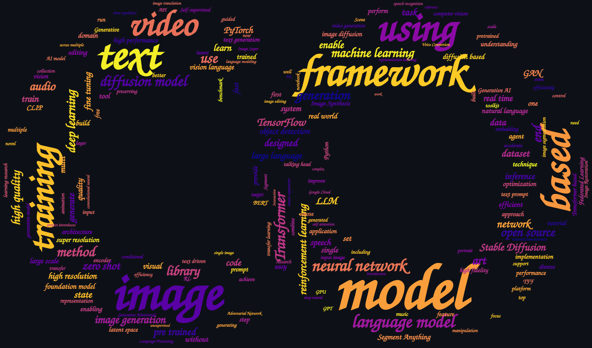

The page might not be rendered properly. Please open [README.md](https://github.com/amrzv/awesome-colab-notebooks/blob/main/README.md) file directly
# Awesome colab notebooks collection for ML experiments
## Trending
| repositories | papers | packages |
|---|---|---|
| <ul><li>TRELLIS.2	</li> <li>magenta-realtime	</li> <li>timesfm	</li> <li>circle-guard-bench	</li> <li>rf-detr	</li> <li>piper1-gpl	</li> <li>presidio	</li> <li>GigaAM	</li> <li>langgraph	</li> <li>ritm-interactive-segmentation	</li> <li>supervision	</li> <li>MinerU	</li> <li>litellm	</li> <li>TabPFN	</li> <li>sam3	</li> <li>PaddleHub	</li> <li>actionmesh	</li> <li>vjepa2	</li> <li>sglang	</li> <li>BiRefNet	</li> <li>crawl4ai	</li></ul> | <ul><li>BEiT	</li> <li>SLiMe	</li> <li>Gemma	</li> <li>clip2latent	</li> <li>EPro-PnP	</li> <li>LM Evaluation Harness	</li> <li>Classify text with BERT	</li> <li>Fine-tuning a BERT	</li> <li>AWQ	</li> <li>FastChat	</li> <li>MobileNet	</li> <li>ALBERT	</li> <li>Once-for-All	</li> <li>trlX	</li> <li>py-irt	</li> <li>Deep Image Prior	</li> <li>Thorsten-Voice	</li> <li>dm_control	</li> <li>deep-significance	</li> <li>Amphion	</li> <li>TorchGeo	</li></ul> | <ul><li>timesfm	</li> <li>scikit-video	</li> <li>presidio-image-redactor	</li> <li>nncf	</li> <li>executorch	</li> <li>dopamine-rl	</li> <li>rfdetr	</li> <li>piper-tts	</li> <li>nemo-toolkit	</li> <li>mujoco	</li> <li>skythought	</li> <li>anthropic	</li> <li>hume-tada	</li> <li>google-adk	</li> <li>rembg	</li> <li>presidio-structured	</li> <li>crewai	</li> <li>google-cloud-datacatalog	</li> <li>sglang-router	</li> <li>datasets	</li> <li>langgraph	</li></ul> |
## Courses

COURSES

| name | description | authors | links | colaboratory | update |
|------|-------------|:--------|:------|:------------:|:------:|
| Python for Algorithmic Trading Cookbook | From raw market data to live algorithmic trading through 68 hands-on recipes across 15 chapters | [Packt](https://www.packtpub.com/) |  <ul><li></li><li>, </li><li>[1](https://www.packtpub.com/en-in/product/python-for-algorithmic-trading-cookbook-9781835084700), [2](https://pyquantnews.substack.com), [3](https://www.amazon.com/Python-Algorithmic-Trading-Cookbook-algorithmic/dp/1806662035/), [4](https://www.oreilly.com/library/view/python-for-algorithmic/9781835084700), [5](https://openlibrary.org/works/OL39133465W/Python_for_Algorithmic_Trading_Cookbook), [6](https://books.google.com/books/about/PYTHON_FOR_ALGORITHMIC_TRADING_COOKBOOK.html?id=EOvX0QEACAAJ), [7](https://www.kobo.com/ww/en/ebook/python-for-algorithmic-trading-cookbook-1), [8](https://www.walmart.com/ip/20472453424), [9](https://bookshop.org/p/books/python-for-algorithmic-trading-cookbook-second-edition-recipes-for-designing-building-and-deploying-algorithmic-trading-strategies-with-python-jason-s/e273b51c87e58d3d?ean=9781806662036), [10](https://www.goodreads.com/book/show/216193548-python-for-algorithmic-trading-cookbook), [11](https://www.drkrzysztofozimek.com/python-algorithmic-trading-cookbook-2nd-edition-review)</li></ul> |  | 23.05.2026 |
| Time Series with PyTorch | Starting with PyTorch fundamentals, you will build neural networks from scratch and progress through recurrent networks, attention mechanisms, and transformers before exploring forecasting architectures such as N-BEATS, N-HiTS, and the Temporal Fusion Transformer | [Packt](https://www.packtpub.com/) |  <ul><li></li><li>[1](https://www.packtpub.com/en-us/product/time-series-with-pytorch-9781805128182), [2](https://www.oreilly.com/library/view/time-series-with/9781805128182), [3](https://www.amazon.com/Time-PyTorch-Real-World-Forecasting-Challenges/dp/1805128183)</li></ul> |  | 08.05.2026 |
| GPU Computing with Python 3 and CUDA | How to accelerate Python applications using NVIDIA’s CUDA platform and a modern ecosystem of Python tools and libraries | [Packt](https://www.packtpub.com/) |  <ul><li></li><li>[1](https://www.packtpub.com/en-us/product/gpu-accelerated-computing-with-python-3-and-cuda-9781803245423), [2](https://www.packtpub.com/en-us/product/gpu-accelerated-computing-with-python-3-and-cuda-9781803248103), [3](https://subscription.packtpub.com/book/programming/9781803245423/pref/preflvl1sec01/preface), [4](https://www.oreilly.com/library/view/gpu-accelerated-computing-with/9781803245423), [5](https://www.amazon.com/GPU-Accelerated-Computing-Python-CUDA-applications/dp/1803245425), [6](https://andlukyane.com/blog/book-review-gpu-cuda-python)</li></ul> |  | 11.04.2026 |
| The Autodiff Cookbook | You'll go through a whole bunch of neat autodiff ideas that you can cherry pick for your own work, starting with the basics | <ul><li>[Alex Wiltschko](https://github.com/alexbw)</li> <li>[Matthew Johnson](http://people.csail.mit.edu/mattjj/)</li></ul> |  <ul><li>, , , </li><li>, </li><li>, ), , </li><li>[1](https://mitpress.mit.edu/sites/default/files/titles/content/sicm_edition_2/book.html), [2](https://mitpress.mit.edu/books/functional-differential-geometry), [3](http://videolectures.net/deeplearning2017_johnson_automatic_differentiation/)</li></ul> |  | 01.04.2026 |
| Practical RL | An open course on reinforcement learning in the wild | <ul><li>[Pavel Shvechikov](https://github.com/pshvechikov)</li> <li>[Nikita Putintsev](https://github.com/qwasser)</li> <li>[Alexander Fritsler](https://github.com/Fritz449)</li> <li>[Oleg Vasilev](https://me.svin.in/)</li></ul>

others
<ul><li>[Dmitry Nikulin](https://github.com/pastafarianist)</li> <li>[Mikhail Konobeev](https://github.com/mknbv)</li> <li>[Ivan Kharitonov](https://kharitonov-ivan.github.io/)</li> <li>[Ravil Khisamov](https://github.com/zshrav)</li> <li>[Anna Klepova](https://github.com/q0o0p)</li> <li>[Fedor Ratnikov](https://github.com/justheuristic)</li></ul>
 |  <ul><li></li><li></li><li></li><li>, , , , , , , , </li><li>[1](https://yadi.sk/d/loPpY45J3EAYfU)</li></ul> |  | 05.03.2026 |
| Deep Learning School course (ML + CV) |  | [Nina Konovalova](https://github.com/Nina-Konovalova) |  <ul><li></li><li>[website](https://dls.samcs.ru/)</li><li>, </li></ul> |  | 04.03.2026 |
| mlcourse.ai | Open Machine Learning Course | [Yury Kashnitsky](https://yorko.github.io/) |  <ul><li></li><li></li><li>[project](https://mlcourse.ai/book/index.html)</li><li></li><li></li><li>[1](https://habr.com/company/ods/blog/344044/)</li></ul> |  | 24.01.2026 |
| Udacity Deep Learning class with TensorFlow | Learn how to apply deep learning to solve complex problems | [Mark Daoust](https://github.com/MarkDaoust) |  <ul><li></li><li>[1](https://www.udacity.com/course/deep-learning--ud730), [2](http://yaroslavvb.blogspot.com/2011/09/notmnist-dataset.html), [3](http://yann.lecun.com/exdb/mnist/)</li></ul> |  | 14.01.2026 |
| Курс "Машинное обучение" на ФКН ВШЭ | Конспекты лекций, материалы семинаров и домашние задания (теоретические, практические, соревнования) по курсу "Машинное обучение", проводимому на бакалаврской программе "Прикладная математика и информатика" Факультета компьютерных наук Высшей школы экономики | [Evgeny Sokolov](https://github.com/esokolov) |  <ul><li>, , , </li><li>[1](http://wiki.cs.hse.ru/%D0%9C%D0%B0%D1%88%D0%B8%D0%BD%D0%BD%D0%BE%D0%B5_%D0%BE%D0%B1%D1%83%D1%87%D0%B5%D0%BD%D0%B8%D0%B5_1), [2](http://wiki.cs.hse.ru/%D0%9C%D0%B0%D1%88%D0%B8%D0%BD%D0%BD%D0%BE%D0%B5_%D0%BE%D0%B1%D1%83%D1%87%D0%B5%D0%BD%D0%B8%D0%B5_2)</li></ul> |  | 14.09.2025 |
| XAI | Дearning explainable artificial intelligence methods | [Сабрина Садиех](https://habr.com/ru/users/sad__sabrina/articles) |  <ul><li></li><li></li><li>[1](https://www.lesswrong.com/posts/AcKRB8wDpdaN6v6ru/interpreting-gpt-the-logit-lens), [2](https://habr.com/ru/articles/1033184), [3](https://habr.com/ru/articles/1063222)</li></ul> |  | 05.09.2025 |
| LLM Engineering Essentials course | 12-week course, created by experts from academia and industry, is designed specifically for developers and engineers | <ul><li>[Stanislav Fedotov](https://github.com/st-fedotov)</li> <li>[Alexey Bukhtiyarov](https://github.com/leshanbog)</li> <li>[Nikita Pavlichenko](https://www.pavlichenko.info/)</li> <li>[Sergei Petrov](https://www.linkedin.com/in/sergei-petrov-12589210b/)</li></ul>

others
<ul><li>[Sergei Skvortsov](https://github.com/southfreebird)</li> <li>[Alex Umnov](https://github.com/AlexUmnov)</li></ul>
 |  <ul><li></li><li>[website](https://academy.nebius.com/llm-engineering-essentials)</li></ul> |  | 22.05.2025 |
| Understanding Language Models | Course deals with language models, in particular (but not exclusively so) on transformer-based language models like GPT-x or LLama | <ul><li>[Michael Franke](https://michael-franke.github.io/)</li> <li>[Carsten Eickhoff](https://github.com/eickhoff)</li> <li>[Polina Tsvilodub](https://polina-tsvilodub.github.io/home/)</li></ul> |  <ul><li>, , </li><li>[website](https://cogsciprag.github.io/Understanding-LLMs-course/intro.html)</li><li></li><li>[1](https://web.stanford.edu/~jurafsky/slp3/)</li></ul> |  | 17.04.2025 |
| Introduction to Deep Learning course |  | [Tatiana Gaintseva](https://atmyre.github.io/) |  <ul><li>, </li><li></li><li></li><li>, , , </li></ul> |  | 24.01.2025 |
| ARENA | Provide talented individuals with the skills, tools, and environment necessary for upskilling in ML engineering, for the purpose of contributing directly to AI alignment in technical roles | [Callum McDougall](https://www.perfectlynormal.co.uk/) |  <ul><li></li><li></li><li>[website](https://arena-resources.notion.site/)</li></ul> |  | 30.12.2024 |
| Deep Learning Course at the University of Amsterdam | Series of Jupyter notebooks that are designed to help you understanding the "theory" from the lectures by seeing corresponding implementations | <ul><li>[Pascal Mettes](https://staff.fnwi.uva.nl/p.s.m.mettes/)</li> <li>[Melika Davood Zadeh](https://www.researchgate.net/profile/Melika-Davood-Zadeh)</li> <li>[Mohammadreza Salehidehnavi](https://smsd75.github.io/)</li> <li>[Danilo de Goede](https://ivi.fnwi.uva.nl/vislab/author/danilo-de-goede/)</li> <li>[Phillip Lippe](https://phlippe.github.io/)</li></ul> |  <ul><li></li><li>[website](https://uvadlc.github.io/)</li><li></li></ul> |  | 17.10.2024 |
| Machine Learning Simplified | A Gentle Introduction to Supervised Learning | [Andrew Wolf](https://5x12.ai/) |  <ul><li></li><li>, </li><li>[website](https://www.themlsbook.com/)</li></ul> |  | 29.08.2024 |
| Anthropic courses | Anthropic's educational courses | [Anthropic](https://www.anthropic.com/) |  <ul><li></li><li></li><li></li><li></li></ul> |  | 22.08.2024 |
| Deep RL Course | The Hugging Face Deep Reinforcement Learning Course | <ul><li>[Thomas Simonini](https://www.simoninithomas.com/)</li> <li>[Omar Sanseviero](https://osanseviero.github.io/hackerllama/)</li> <li>[Sayak Paul](https://sayak.dev/)</li></ul> |  <ul><li></li><li></li><li>, </li><li></li><li>, , </li><li>[1](https://simoninithomas.github.io/deep-rl-course)</li></ul> |  | 24.06.2024 |
| Anthropic's Prompt Engineering Interactive Tutorial | Course is intended to provide you with a comprehensive step-by-step understanding of how to engineer optimal prompts within Claude | [Anthropic](https://www.anthropic.com/) |  <ul><li></li><li></li><li></li><li>, </li></ul> |  | 02.04.2024 |
| Generative AI for Beginners - A Course | A 12 Lesson course teaching everything you need to know to start building Generative AI applications | [microsoft](https://www.microsoft.com/) |  <ul><li></li><li>[project](https://microsoft.github.io/generative-ai-for-beginners/)</li><li>[1](https://aka.ms/genai-discord)</li></ul> |  | 22.02.2024 |
| Deep Reinforcement Learning | CS 285 at UC Berkeley | <ul><li>[Sergey Levine](https://people.eecs.berkeley.edu/~svlevine/)</li> <li>[Kyle Stachowicz](https://kylestaschowicz.com)</li> <li>[Vivek Myers](https://vmyers.github.io)</li> <li>[Joey Hong](https://joeyhong123.github.io)</li></ul>

others
<ul><li>[Kevin Black](https://kvablack.github.io)</li> <li>[Michael Janner](https://people.eecs.berkeley.edu/~janner/)</li> <li>[Vitchyr Pong](https://vitchyr.github.io)</li> <li>[Aviral Kumar](https://aviralkumar2907.github.io)</li></ul>
 |  <ul><li>[website](http://rail.eecs.berkeley.edu/deeprlcourse/)</li><li>, </li><li>[1](https://www.coursera.org/course/neuralnets), [2](https://www.coursera.org/learn/machine-learning/)</li></ul> |  | 29.08.2023 |
| npNLG | The course introduces the basics of NLG, neural language models and their implementation in PyTorch, as well as a selection of recent pragmatic neural NLG approaches | [Michael Franke](https://github.com/michael-franke) |   <ul><li></li><li>[1](https://michael-franke.github.io/npNLG/000-intro.html)</li></ul> |  | 09.11.2022 |
| DSP theory | Theory of digital signal processing: signals, filtration (IIR, FIR, CIC, MAF), transforms (FFT, DFT, Hilbert, Z-transform) etc | <ul><li>[Alexander Kapitanov](https://github.com/hukenovs)</li> <li>[Vladimir Fadeev](https://github.com/kirlf)</li> <li>[Karina Kvanchiani](https://github.com/karinakvanchiani)</li> <li>[Elizaveta Petrova](https://github.com/kleinsbotle)</li> <li>[Andrei Makhliarchuk](https://github.com/anotherhelloworld)</li></ul> |  <ul><li>[1](https://habr.com/ru/articles/460445/)</li></ul> |  | 18.10.2022 |
| Machine learning course | This course is broad and shallow, but author will provide additional links so that you can deepen your understanding of the ML method you need | [Тимчишин Віталій](https://github.com/fbeilstein) |  <ul><li>, , , , , , , , , , </li><li>[1](https://vas3k.com/blog/machine_learning/)</li></ul> |  | 02.09.2021 |
| Intro to TensorFlow for Deep Learning | Dive into deep learning with this practical course on TensorFlow and the Keras API | <ul><li>[Magnus Hyttsten](https://www.linkedin.com/in/magnushyttsten)</li> <li>[Juan Delgado](https://www.linkedin.com/in/juan-delgado-845749179)</li> <li>[Paige Bailey](https://webpaige.dev/)</li></ul> |  <ul><li>[1](https://www.udacity.com/course/intro-to-tensorflow-for-deep-learning--ud187)</li></ul> |  | 09.09.2020 |
| Introduction to TensorFlow Lite | Learn how to deploy deep learning models on mobile and embedded devices with TensorFlow Lite | <ul><li>[Daniel Situnayake](https://situnayake.com/)</li> <li>[Paige Bailey](https://webpaige.dev/)</li> <li>[Juan Delgado](https://www.linkedin.com/in/juan-delgado-845749179)</li></ul> |  <ul><li>[1](https://www.udacity.com/course/intro-to-tensorflow-lite--ud190)</li></ul> |  | 09.09.2020 |
| NYU-DLSP20 | This course concerns the latest techniques in deep learning and representation learning, focusing on supervised and unsupervised deep learning, embedding methods, metric learning, convolutional and recurrent nets, with applications to computer vision, natural language understanding, and speech recognition | <ul><li>[Yann LeCun](https://yann.lecun.com/)</li> <li>[Alfredo Canziani](https://atcold.github.io/)</li></ul> |  <ul><li></li><li>, </li><li></li><li>[website](https://atcold.github.io/NYU-DLSP20/)</li><li></li></ul> |  | 30.10.2019 |

## Projects

PROJECTS

| name | description | authors | links | colaboratory | update |
|------|-------------|:--------|:------|:------------:|:------:|
| Kornia | Library is composed by a subset of packages containing operators that can be inserted within neural networks to train models to perform image transformations, epipolar geometry, depth estimation, and low-level image processing such as filtering and edge detection that operate directly on tensors | <ul><li>[Edgar Riba](https://github.com/edgarriba)</li> <li>[Dmytro Mishkin](https://dmytro.ai/)</li> <li>[Daniel Ponsa](https://github.com/DanielPonsa)</li> <li>[Ethan Rublee](https://github.com/ethanrublee)</li> <li>[Gary Bradski](https://github.com/garybradski)</li></ul> |   <ul><li></li><li></li><li></li><li></li><li></li><li></li><li>[website](https://kornia.github.io/)</li><li>, , </li><li>[1](https://opencv.org/kornia-an-open-source-differentiable-computer-vision-library-for-pytorch/)</li></ul> |  | 05.08.2026 |
| Retrieval based Voice Conversion WebUI | An easy-to-use Voice Conversion framework based on VITS | [源文雨](https://github.com/fumiama) |  <ul><li></li><li>, , , , , </li><li></li><li></li><li>, , , , </li></ul> |  | 04.08.2026 |
| SGLang | System comprising a frontend language and runtime for efficiently programming and executing complex structured language model programs with optimizations for cache reuse and structured output decoding. | <ul><li>[Lianmin Zheng](https://lmzheng.net)</li> <li>[Liangsheng Yin](https://www.lsyin.me)</li> <li>[Zhiqiang Xie](https://zhiqiangxie.com)</li> <li>[Chuyue Sun](https://web.stanford.edu/~chuyues)</li></ul>

others
<ul><li>[Jeff Huang](https://engineering.tamu.edu/cse/profiles/huang-jeff.html)</li> <li>[Cody Hao Yu](https://comaniac.github.io)</li> <li>[Shiyi Cao](https://shiyicao.com)</li> <li>[Christos Kozyrakis](https://csl.stanford.edu/~christos)</li> <li>[Ion Stoica](https://www2.eecs.berkeley.edu/Faculty/Homepages/stoica.html)</li> <li>[Joseph E. Gonzalez](https://people.eecs.berkeley.edu/~jegonzal)</li> <li>[Clark Barrett](https://profiles.stanford.edu/clark-barrett)</li> <li>[Ying Sheng](https://sites.google.com/view/yingsheng/publications)</li></ul>
 |  <ul><li></li><li></li><li></li><li>, , , , , , , , , , , , , </li><li>, </li><li></li><li></li><li>, </li><li>[website](https://www.sglang.io)</li><li></li><li>[1](https://lmsys.org/blog), [2](https://slack.sglang.io), [3](https://a16z.com/advancing-open-source-ai-through-benchmarks-and-bold-experimentation), [4](https://www.amd.com/en/developer/resources/technical-articles/amd-instinct-gpus-power-deepseek-v3-revolutionizing-ai-development-with-sglang.html), [5](https://lmsysorg.mintlify.app/docs), [6](https://dl.acm.org/doi/10.5555/3737916.3739916)</li></ul> |  | 04.08.2026 |
| SHAP | SHapley Additive exPlanations is a game theoretic approach to explain the output of any machine learning model | <ul><li>[Scott Lundberg](https://scottlundberg.com/)</li> <li>[Su-In Lee](https://www.cs.washington.edu/people/faculty/su-in-lee/)</li></ul> |   <ul><li>, , , </li><li>, </li><li></li><li>, , , , , </li></ul> |  | 03.08.2026 |
| YOLOv8 | State-of-the-art model that builds upon the success of previous YOLO versions and introduces new features and improvements to further boost performance and flexibility | [Glenn Jocher](https://github.com/glenn-jocher) |   <ul><li></li><li></li><li></li><li></li><li></li><li>, , , , , </li><li>[1](https://ultralytics.com/discord), [2](http://cocodataset.org/), [3](https://www.image-net.org/), [4](https://habr.com/ru/articles/710016/)</li></ul> |  | 01.08.2026 |
| YOLOv3 | You Only Look Once | [Glenn Jocher](https://github.com/glenn-jocher) |  <ul><li>, </li><li>[1](http://cocodataset.org/#upload)</li></ul> |  | 29.07.2026 |
| YOLOv5 | You Only Look Once | [Glenn Jocher](https://github.com/glenn-jocher) |  <ul><li>, </li><li>[1](http://cocodataset.org/#upload)</li></ul> |  | 29.07.2026 |
| dm_control | DeepMind Infrastructure for Physics-Based Simulation | <ul><li>[Saran Tunyasuvunakool](https://github.com/saran-t)</li> <li>[Alistair Muldal](https://github.com/alimuldal)</li> <li>[Yotam Doron](http://www.yotamdoron.com/)</li> <li>[Siqi Liu](http://siqi.fr/)</li></ul>

others
<ul><li>[Steven Bohez](https://github.com/sbohez)</li> <li>[Josh Merel](https://sites.google.com/site/jsmerel/)</li> <li>[Tom Erez](https://github.com/erez-tom)</li> <li>[Timothy Lillicrap](https://contrastiveconvergence.net/~timothylillicrap/index.php)</li> <li>[Nicolas Heess](https://scholar.google.com/citations?user=79k7bGEAAAAJ)</li> <li>[Yuval Tassa](https://github.com/yuvaltassa)</li></ul>
 |   <ul><li>, , , , , </li><li></li><li></li><li></li><li>, , </li></ul> |  | 28.07.2026 |
| ADK | Collection provides ready-to-use agents built on top of the Agent Development Kit, designed to accelerate your development process | <ul><li>[Equious](https://github.com/Equious)</li> <li>[Ankur Sharma](https://github.com/ankursharmas)</li></ul> |  <ul><li></li><li>, </li><li></li><li></li><li></li><li>, , , , , , , </li><li>[1](https://google.github.io/adk-docs/), [2](https://developers.googleblog.com/en/agent-development-kit-easy-to-build-multi-agent-applications/)</li></ul> |  | 24.07.2026 |
| OmegaConf | Hierarchical configuration system, with support for merging configurations from multiple sources providing a consistent API regardless of how the configuration was created | [Omry Yadan](https://github.com/omry) |  <ul><li>, </li><li></li></ul> |  | 22.07.2026 |
| Agent Starter Pack | Collection of production-ready Generative AI Agent templates built for Google Cloud | [Kristopher Overholt](https://github.com/koverholt) |  <ul><li>, </li><li></li><li></li><li>, , , </li></ul> |  | 21.07.2026 |
| AlphaFold | Highly accurate protein structure prediction | <ul><li>[John Jumper](https://scholar.google.com/citations?user=a5goOh8AAAAJ)</li> <li>[Richard Evans](http://www.doc.ic.ac.uk/~re14/)</li> <li>[Alexander Pritzel](https://scholar.google.com/citations?user=GPgAyU0AAAAJ)</li> <li>[Tim Green](http://tfgg.me/)</li></ul>

others
<ul><li>[Michael Figurnov](https://figurnov.ru/)</li> <li>[Olaf Ronneberger](https://lmb.informatik.uni-freiburg.de/people/ronneber/)</li> <li>[Kathryn Tunyasuvunakool](https://scholar.google.com/citations?user=eEqNGagAAAAJ)</li> <li>[Russ Bates](https://scholar.google.com/citations?user=Koes5ewAAAAJ)</li> <li>[Augustin Žídek](https://augustin.zidek.eu/)</li> <li>[Anna Potapenko](http://apotapenko.com/)</li> <li>[Alex Bridgland](https://scholar.google.com/citations?user=VWmXKPMAAAAJ)</li> <li>[Clemens Meyer](https://scholar.google.com/citations?user=EWLZiM8AAAAJ)</li> <li>[Simon Kohl](https://www.simonkohl.com/)</li> <li>[Andrew Ballard](https://scholar.google.com/citations?user=syjQhAMAAAAJ)</li> <li>[Bernardino Romera-Paredes](https://sites.google.com/site/romeraparedes/)</li> <li>[Stanislav Nikolov](https://scholar.google.co.uk/citations?user=O-b7pBEAAAAJ)</li> <li>[Rishub Jain](http://rishub.me/)</li></ul>
 |   <ul><li>, </li><li>, , </li><li></li><li></li><li>, </li><li>[1](https://www.nature.com/articles/s41586-021-03828-1)</li></ul> |  | 14.07.2026 |
| GigaAM | SSL pretraining framework that leverages masked language modeling with targets derived from a speech recognition model | <ul><li>[Aleksandr Kutsakov](https://github.com/Alexander4127)</li> <li>[Alexandr Maximenko](https://github.com/AlexMaximenko)</li> <li>[Georgii Gospodinov](https://github.com/georgygospodinov)</li> <li>[Pavel Bogomolov](https://github.com/Bobrosoft98)</li> <li>[Fyodor Minkin](https://www.researchgate.net/profile/Fyodor-Minkin)</li></ul> |  <ul><li>, , , , </li><li>, </li><li></li><li>, , , </li><li>[1](https://habr.com/ru/companies/sberdevices/articles/805569)</li></ul> |  | 14.07.2026 |
| s | This paper introduces O-Voxel, a new sparse voxel representation and compression framework that enables high-fidelity, efficient 3D asset generation with flexible geometry and detailed appearance from learned compact latent spaces | <ul><li>[Jianfeng Xiang](https://www.jianxiang.info)</li> <li>[Xiaoxue Chen](https://cxx226.github.io)</li> <li>[Sicheng Xu](https://dblp.org/pid/238/0224)</li> <li>[Ruicheng Wang](https://wrc042.github.io)</li></ul>

others
<ul><li>[Zelong Lv](https://openreview.net/profile?id=~Zelong_Lv1)</li> <li>[Yu Deng](https://sites.google.com/uchicago.edu/yudeng)</li> <li>[Hongyuan Zhu](https://hongyuanzhu.github.io)</li> <li>[Yue Dong](https://yuedong.us)</li> <li>[Hao Zhao](https://evanhaozhao.github.io)</li> <li>[Nicholas Jing Yuan](https://dblp.org/pid/131/4855)</li> <li>[Jiaolong Yang](http://jlyang.org)</li></ul>
 |  <ul><li></li><li>, , , </li><li>, </li><li>[project](https://trellis-2.org)</li><li>[1](https://microsoft.github.io/TRELLIS.2), [2](https://www.microsoft.com/en-us/research/articles/trellis-2), [3](https://3daistudio.com/Platform/API/Documentation/3d-generation/trellis2), [4](https://build.nvidia.com/microsoft/trellis)</li></ul> |  | 09.07.2026 |
| NeMo | A conversational AI toolkit built for researchers working on automatic speech recognition, natural language processing, and text-to-speech synthesis | <ul><li>[Oleksii Kuchaiev](http://kuchaev.com/)</li> <li>[Jason Li](https://scholar.google.com/citations?user=V28bxDwAAAAJ)</li> <li>[Chip Huyen](https://huyenchip.com/)</li> <li>[Oleksii Hrinchuk](https://github.com/AlexGrinch)</li></ul>

others
<ul><li>[Ryan Leary](https://github.com/ryanleary)</li> <li>[Boris Ginsburg](https://github.com/borisgin)</li> <li>[Samuel Kriman](https://github.com/sam1373)</li> <li>[Stanislav Beliaev](https://github.com/stasbel)</li> <li>[Vitaly Lavrukhin](https://github.com/vsl9)</li> <li>[Jack Cook](https://jackcook.com/)</li></ul>
 |  <ul><li></li><li>, , </li><li>, </li><li></li></ul> |  | 07.07.2026 |
| Anime Face Detector | Anime Face Detector using mmdet and mmpose | [hysts](https://huggingface.co/hysts) |  <ul><li>, , , , </li><li>, , , </li><li></li><li></li></ul> |  | 05.07.2026 |
| Chronos-2 | Pretrained, zero-shot time series forecasting model that uses group attention and synthetic multivariate training to perform univariate, multivariate, and covariate-informed forecasting with state-of-the-art accuracy across diverse real-world benchmarks. | <ul><li>[Abdul Fatir Ansari](https://clear-nus.github.io/fatir)</li> <li>[Oleksandr Shchur](https://shchur.github.io)</li> <li>[Jaris Küken](https://www.amazon.science/author/jaris-kuken)</li> <li>[Andreas Auer](https://www.jku.at/en/institute-for-machine-learning/about-us/team/dipl-ing-andreas-auer)</li></ul>

others
<ul><li>[Boran Han](https://boranhan.github.io)</li> <li>[Pedro Mercado](https://melopeo.github.io)</li> <li>[Syama Sundar Rangapuram](https://dblp.org/pid/30/11348)</li> <li>[Huibin Shen](https://www.amazon.science/author/huibin-shen)</li> <li>[Lorenzo Stella](https://lostella.github.io)</li> <li>[Xiyuan Zhang](https://xiyuanzh.github.io)</li> <li>[Mononito Goswami](https://mononito.com)</li> <li>[Shubham Kapoor](https://www.shubhamkapoor.site)</li> <li>[Danielle C. Maddix](https://openreview.net/profile?id=~Danielle_C._Maddix1)</li> <li>[Pablo Guerron](https://sites.google.com/site/pabloaguerronquintana)</li> <li>[Tony Hu](https://www.jiangdonghu.com)</li> <li>[Junming Yin](https://junmingy.github.io)</li> <li>[Nick Erickson](https://scholar.google.com/citations?user=innixma)</li> <li>[Prateek Mutalik Desai](https://github.com/prateekdesai04)</li> <li>[Hao Wang](https://people.csail.mit.edu/haow)</li> <li>[Huzefa Rangwala](https://cs.gmu.edu/~rangwala)</li> <li>[George Karypis](https://karypis.github.io)</li> <li>[Yuyang Wang](https://wangyy.phd)</li> <li>[Michael Bohlke-Schneider](https://openreview.net/profile?id=~Michael_Bohlke-Schneider1)</li></ul>
 |  <ul><li>, </li><li></li><li>, , , , , </li><li>[1](https://auto.gluon.ai/dev/tutorials/timeseries/forecasting-chronos.html), [2](https://autogluon.com/chronos), [3](https://www.amazon.science/blog/introducing-chronos-2-from-univariate-to-universal-forecasting), [4](https://unit8co.github.io/darts/generated_api/darts.models.forecasting.chronos2_model.html)</li></ul> |  | 02.07.2026 |
| Nano Banana | An image generation and editing model powered by generative artificial intelligence and developed by Google DeepMind | [Guillaume Vernade](https://github.com/Giom-V) | <ul><li></li><li>[website](https://aistudio.google.com/models/gemini-2-5-flash-image)</li><li></li><li>, , , , , , </li><li>[1](https://ai.google.dev/gemini-api/docs/image-generation), [2](https://blog.google/technology/ai/nano-banana-pro), [3](https://deepmind.google/models/gemini-image/pro/), [4](https://deepmind.google/models/gemini-image/flash/)</li></ul> |  | 30.06.2026 |
| Presidio | Context aware, pluggable and customizable PII de-identification service for text and images | [Omri Mendels](https://github.com/omri374) |  <ul><li>, , </li><li>, </li><li>, , , </li><li>, , , , </li><li>[1](https://microsoft.github.io/presidio/), [2](https://aka.ms/presidio-demo)</li></ul> |  | 28.06.2026 |
| Weaver | Lightweight autoregressive adapter for factorized draft models that constructs proposal trees from top-K marginals to restore conditional dependencies and enable faster speculative decoding with optimized tree verification and CUDA kernels in SGLang. | <ul><li>[Yuma Oda](https://github.com/osawayuma)</li> <li>[Ryan Mathieu](https://www.linkedin.com/in/ryan-mathieu-62b61523b)</li> <li>[Roman Knyazhitskiy](https://knyaz.tech)</li> <li>[Artur Chakhvadze](https://github.com/norpadon)</li></ul> |  <ul><li>, , , , </li><li></li><li>, , , , , , , , , , , , , , </li><li>, </li><li></li><li>, </li><li>, </li><li>[website](https://www.sglang.io)</li><li></li><li>, </li><li>[1](https://deepwiki.com/sgl-project/sglang), [2](https://lmsys.org/blog), [3](https://roadmap.sglang.io), [4](https://slack.sglang.io), [5](https://meet.sglang.io), [6](https://a16z.com/advancing-open-source-ai-through-benchmarks-and-bold-experimentation), [7](https://www.amd.com/en/developer/resources/technical-articles/amd-instinct-gpus-power-deepseek-v3-revolutionizing-ai-development-with-sglang.html), [8](https://sgl-project.github.io), [9](https://github.laiyagushi.com/sgl-project)</li></ul> |  | 24.06.2026 |
| TransformerLens | Library for doing mechanistic interpretability of GPT-2 Style language models | <ul><li>[Neel Nanda](https://www.neelnanda.io/about)</li> <li>[Joseph Bloom](https://github.com/jbloomAus)</li></ul> |  <ul><li>, </li><li></li><li></li><li></li><li></li><li>, </li><li>[1](https://transformerlensorg.github.io/TransformerLens/)</li></ul> |  | 22.06.2026 |
| Hyperopt | Python library for serial and parallel optimization over awkward search spaces, which may include real-valued, discrete, and conditional dimensions | <ul><li>[James Bergstra](https://github.com/jaberg)</li> <li>[Dan Yamins](https://github.com/yamins81)</li> <li>[David Cox](https://scholar.google.com/citations?user=6S-WgLkAAAAJ)</li></ul> |  <ul><li>, , , , </li><li></li><li>, , </li><li>[1](http://hyperopt.github.io/hyperopt/), [2](https://proceedings.mlr.press/v28/bergstra13.html)</li></ul> |  | 21.06.2026 |
| highway-env | A collection of environments for autonomous driving and tactical decision-making tasks | [Edouard Leurent](https://edouardleurent.com/) |  <ul><li>, , </li><li></li><li>, , </li></ul> |  | 19.06.2026 |
| SentencePiece | An unsupervised text tokenizer and detokenizer mainly for Neural Network-based text generation systems where the vocabulary size is predetermined prior to the neural model training | <ul><li>[Taku Kudo](http://chasen.org/~taku/)</li> <li>[John Richardson](https://scholar.google.com/citations?user=PEvmYfgAAAAJ)</li></ul> |  <ul><li>, , , , </li><li>, , , </li><li></li><li></li><li></li></ul> |  | 14.06.2026 |
| RF-DETR | Lightweight, real-time detection transformer that uses weight-sharing neural architecture search to automatically discover optimal accuracy-latency tradeoffs for object detection across diverse target datasets. | <ul><li>[Isaac Robinson](https://isaac-robinson.com)</li> <li>Peter Robicheaux</li> <li>[Matvei Popov](https://matvezy.com)</li> <li>[Deva Ramanan](https://www.ri.cmu.edu/ri-faculty/deva-kannan-ramanan)</li> <li>[Neehar Peri](https://www.neeharperi.com)</li></ul> |   <ul><li>, , , , , </li><li>[blog](https://blog.roboflow.com/rf-detr)</li><li></li><li>, </li><li></li><li></li><li>, , , , </li><li>[website](https://rfdetr.roboflow.com)</li><li></li><li>[1](https://www.digitalocean.com/community/tutorials/rf-detr-real-time-object-detection)</li></ul> |  | 13.06.2026 |
| Mem0 | Self-improving memory layer for LLM applications, enabling personalized AI experiences that save costs and delight users | <ul><li>[Prateek Chhikara](https://www.prateekchhikara.com/)</li> <li>[Dev Khant](https://github.com/Dev-Khant)</li> <li>[Saket Aryan](https://saketaryan.xyz/)</li> <li>[Taranjeet Singh](https://taranjeet.co/about/)</li> <li>[Deshraj Yadav](http://deshraj.xyz/)</li></ul> |  <ul><li></li><li></li><li></li><li></li><li></li><li>[website](https://mem0.ai/)</li><li>, </li><li>[1](https://mem0.dev/DiG), [2](https://app.mem0.ai/)</li></ul> |  | 13.06.2026 |
| Swarm | Educational framework exploring ergonomic, lightweight multi-agent orchestration | <ul><li>[Ilan Bigio](https://ilanbigio.com/)</li> <li>[James Hills](https://github.com/jhills20)</li> <li>[Shyamal Anadkat](https://shyamal.me/)</li> <li>[Charu Jaiswal](https://github.com/charuj)</li></ul>

others
<ul><li>[Colin Jarvis](https://github.com/colin-openai)</li> <li>[Katia Guzman](https://github.com/katia-openai)</li></ul>
 |  <ul><li></li><li></li><li>, , , </li><li>[1](https://ai.plainenglish.io/openai-releases-swarm-what-is-it-b61ecb88d67e)</li></ul> |  | 07.06.2026 |
| Duo | This software project implements Duo, a diffusion-based language modeling framework that improves discrete diffusion text generation using Gaussian-guided curriculum learning and Discrete Consistency Distillation for faster training and few-step sampling. | <ul><li>[Subham Sekhar Sahoo](https://s-sahoo.com)</li> <li>[Justin Deschenaux](https://people.epfl.ch/justin.deschenaux)</li> <li>[Aaron Gokaslan](https://skylion007.github.io)</li> <li>[Guanghan Wang](https://www.guanghanwang.com)</li></ul>

others
<ul><li>[Justin Chiu](https://www.jttchiu.com)</li> <li>[Volodymyr Kuleshov](https://www.cs.cornell.edu/~kuleshov)</li></ul>
 |  <ul><li>, </li><li>, , , </li><li>[project](https://s-sahoo.com/duo)</li><li></li><li>[1](https://tech.cornell.edu/people/guanghan-wang)</li></ul> |  | 03.06.2026 |
| Magenta RT | An open-weights live music model that allows you to interactively create, control and perform music in the moment | [Chris Donahue](https://chrisdonahue.com/) |  <ul><li>, , </li><li></li><li></li><li></li><li>, , , , </li><li>[1](https://ai.google.dev/gemini-api/docs/music-generation), [2](https://magenta.withgoogle.com/magenta-realtime), [3](https://labs.google/fx/tools/music-fx-dj/unsupported-country)</li></ul> |  | 02.06.2026 |
| TorchGeo | PyTorch domain library that provides datasets, transforms, samplers, and pre-trained models specific to geospatial data | <ul><li>[Adam Stewart](https://github.com/adamjstewart)</li> <li>[Caleb Robinson](https://calebrob.com/)</li> <li>[Isaac Corley](https://github.com/isaaccorley)</li> <li>[Anthony Ortiz](https://github.com/anthonymlortiz)</li></ul>

others
<ul><li>[Juan Lavista Ferres](https://www.microsoft.com/en-us/research/people/jlavista/)</li> <li>[Arindam Banerjee](https://arindam.cs.illinois.edu/)</li></ul>
 |   <ul><li></li><li></li><li></li><li></li><li></li><li></li><li>[1](https://gisgeography.com/ndvi-normalized-difference-vegetation-index/), [2](https://custom-scripts.sentinel-hub.com/custom-scripts/sentinel-2/ndwi/), [3](https://www.linkedin.com/pulse/ndvi-ndbi-ndwi-calculation-using-landsat-7-8-tek-bahadur-kshetri/), [4](https://www.cogeo.org/)</li></ul> |  | 01.06.2026 |
| pymdp | Package for simulating Active Inference agents in Markov Decision Process environments | <ul><li>[Conor Heins](https://github.com/conorheins)</li> <li>[Alec Tschantz](https://github.com/alec-tschantz)</li> <li>[Beren Millidge](https://www.beren.io/)</li> <li>[Brennan Klein](https://github.com/jkbren)</li></ul>

others
<ul><li>[Arun Niranjan](https://github.com/Arun-Niranjan)</li> <li>[Daphne Demekas](https://github.com/daphnedemekas)</li></ul>
 |  <ul><li></li><li></li></ul> |  | 29.05.2026 |
| ActionMesh | Temporal 3D diffusion framework that generates production-ready, topology-consistent animated 3D meshes from inputs like video, text, or static 3D shapes in a fast, feed-forward manner. | <ul><li>[Remy Sabathier](https://remysabathier.github.io/RemySabathier)</li> <li>[David Novotny](https://d-novotny.github.io)</li> <li>[Niloy J. Mitra](https://www0.cs.ucl.ac.uk/staff/n.mitra)</li> <li>[Tom Monnier](https://tmonnier.com)</li></ul> |  <ul><li></li><li>, , </li><li>, , , , , </li><li>, </li><li></li><li>[1](https://download.blender.org/release/Blender3.5), [2](https://sam2.metademolab.com/demo), [3](https://jnack.com/blog/2026/02/01/actionmesh-turns-video-into-3d)</li></ul> |  | 28.05.2026 |
| Lyria 2 | Delivers high-fidelity music and professional-grade audio, capturing subtle nuances across a range of genres and intricate compositions | [Katie Nguyen](https://github.com/katiemn) | <ul><li></li><li></li><li>[1](https://deepmind.google/models/lyria/), [2](https://cloud.google.com/vertex-ai/generative-ai/docs/music/generate-music)</li></ul> |  | 13.05.2026 |
| Video Seal | Comprehensive framework for neural video watermarking and a competitive open-sourced model | <ul><li>[Pierre Fernandez](https://pierrefdz.github.io/)</li> <li>[Hady Elsahar](https://www.hadyelsahar.io/)</li> <li>[Zeki Yalniz](https://ai.meta.com/people/274060152308398/i-zeki-yalniz/)</li> <li>[Alexandre Mourachko](https://scholar.google.com/citations?user=OD9-erYAAAAJ)</li></ul> |  <ul><li>, </li><li>[demo](https://aidemos.meta.com/videoseal)</li><li></li><li></li></ul> |  | 11.05.2026 |
| Google Cloud Text-to-Speech | Enables easy integration of Google text recognition technologies into developer applications | <ul><li>[Holt Skinner](https://github.com/holtskinner)</li> <li>[Ivan Nardini](https://github.com/inardini)</li></ul> |  <ul><li></li><li>[website](https://cloud.google.com/text-to-speech)</li><li>, , , , , , , </li><li>[1](https://cloud.google.com/python/docs/reference/texttospeech/latest/summary_overview)</li></ul> |  | 07.05.2026 |
| Imagen 4 | Text-to-image model, with photorealistic images, near real-time speed, and sharper clarity | [Katie Nguyen](https://github.com/katiemn) | <ul><li></li><li>, </li><li>[1](https://deepmind.google/models/imagen/), [2](https://developers.googleblog.com/en/imagen-4-now-available-in-the-gemini-api-and-google-ai-studio/)</li></ul> |  | 06.05.2026 |
| CrewAI | Lean, lightning-fast Python framework built entirely from scratch—completely independent of LangChain or other agent frameworks | [João Moura](https://github.com/joaomdmoura) |  <ul><li></li><li></li><li>, </li><li>, </li><li>[website](https://crewai.com/)</li><li>, , , , , , , , </li><li>[1](https://app.crewai.com/), [2](https://learn.crewai.com/), [3](https://www.coursera.org/projects/multi-ai-agent-systems-with-crewai)</li></ul> |  | 20.04.2026 |
| CodeGemma | How to load, fine-tune and deploy CodeGemma model on SQL by utilising Hugging Face | [Carlo Fisicaro](https://github.com/carlofisicaro) | <ul><li></li><li></li><li></li><li></li><li></li><li>[1](https://ai.google.dev/gemma/docs/codegemma)</li></ul> |  | 20.04.2026 |
| Hello, many worlds | This tutorial shows how a classical neural network can learn to correct qubit calibration errors | [Michael Broughton](https://github.com/MichaelBroughton) | <ul><li>, , </li><li></li><li></li></ul> |  | 18.04.2026 |
| Text Generation Web UI | The best local UI for large language models, with easy setup and powerful features. 100% offline. | [oobabooga](https://github.com/oobabooga) |  <ul><li></li><li></li><li>, , , , , , </li><li>, , , </li><li></li><li>[1](https://go.warp.dev/text-generation-webui), [2](https://tfwol.github.io/text-generation-webui), [3](https://jimmysong.io/ai/text-generation-webui), [4](https://tokk-nv.github.io/jetson-generative-ai-playground/tutorial_text-generation.html)</li></ul> |  | 13.04.2026 |
| DataChain | AI-dataframe to enrich, transform and analyze data from cloud storages for ML training and LLM apps | [Daniel K](https://github.com/volkfox) |  <ul><li></li><li></li><li>, </li><li>[1](https://datachain.dvc.ai/), [2](https://dvc.org/chat)</li></ul> |  | 13.04.2026 |
| JAX MD | Differentiable physics and molecular dynamics simulation framework in JAX that enables scalable, GPU-accelerated simulations and end-to-end optimization of entire trajectories, with flexible primitives and neural network integration. | <ul><li>[Samuel S. Schoenholz](https://www.samuelsschoenholz.com)</li> <li>[Ekin D. Cubuk](https://scholar.harvard.edu/efthimios_kaxiras/ekin-dogus)</li></ul> |   <ul><li>, , , , , , </li><li></li><li></li><li></li><li>, , </li><li></li><li>[1](https://www.nature.com/articles/s41524-023-01189-z), [2](https://www.nature.com/articles/s41586-023-06735-9), [3](https://www.nature.com/articles/s41467-021-27241-4), [4](https://haruiz.github.io/blog/accelerating-science-with-jax-simulations-physics-and-beyond)</li></ul> |  | 05.04.2026 |
| GraphCast | Learning skillful medium-range global weather forecasting | <ul><li>[Rémi Lam](https://github.com/remilam)</li> <li>[Alvaro Sanchez-Gonzalez](https://github.com/alvarosg)</li> <li>[Matthew Willson](https://github.com/mjwillson)</li> <li>[Peter Wirnsberger](https://pewi.org/)</li></ul>

others
<ul><li>[Meire Fortunato](https://scholar.google.com/citations?user=_fMHSIUAAAAJ)</li> <li>[Ferran Alet](https://scholar.google.com/citations?user=1lmBq3QAAAAJ)</li> <li>[Suman Ravuri](https://www.linkedin.com/in/suman-ravuri-81928082)</li> <li>[Timo Ewalds](https://github.com/tewalds)</li> <li>[Zach Eaton-Rosen](https://scholar.google.com/citations?user=mQ3zD_wAAAAJ)</li> <li>[Weihua Hu](https://weihua916.github.io/)</li> <li>[Alexander Merose](https://alex.merose.com/)</li> <li>[Stephan Hoyer](https://stephanhoyer.com/)</li> <li>[George Holland](https://www.linkedin.com/in/g-aracil-holland)</li> <li>[Oriol Vinyals](https://research.google/people/oriol-vinyals/)</li> <li>[Jacklynn Stott](https://linkedin.com/in/jacklynnstott)</li> <li>[Alexander Pritzel](https://github.com/a-pritzel)</li> <li>[Shakir Mohamed](https://www.shakirm.com/)</li> <li>[Peter Battaglia](https://scholar.google.com/citations?user=nQ7Ij30AAAAJ)</li></ul>
 |   <ul><li></li><li>, , , , </li><li>, , , , </li><li>[1](https://www.ecmwf.int/en/forecasts/datasets/reanalysis-datasets/era5), [2](https://deepmind.google/discover/blog/graphcast-ai-model-for-faster-and-more-accurate-global-weather-forecasting/), [3](https://towardsdatascience.com/graphcast-how-to-get-things-done-f2fd5630c5fb)</li></ul> |  | 30.03.2026 |
| ignite | High-level library to help with training and evaluating neural networks in PyTorch flexibly and transparently. | [Anmol Joshi](https://github.com/anmolsjoshi) |  <ul><li></li><li></li><li></li><li>, , , , , , , , , , , , , , , , , , , , , , , , , , , , , , , , , , , </li><li>, </li><li></li><li></li><li></li><li>[1](https://numfocus.org/sponsored-projects/affiliated-projects), [2](https://pytorch-ignite.ai), [3](https://discuss.pytorch.org/c/ignite), [4](https://labs.quansight.org/blog/2021/06/distributed-made-easy-with-ignite), [5](https://labs.quansight.org/blog/2020/09/pytorch-ignite), [6](https://code-generator.pytorch-ignite.ai), [7](https://towardsdatascience.com/once-upon-a-repository-how-to-write-readable-maintainable-code-with-pytorch-951f03f6a829), [8](https://towardsdatascience.com/pytorch-ignite-classifying-tiny-imagenet-with-efficientnet-e5b1768e5e8f), [9](https://clear.ml/docs/latest/docs/integrations/ignite), [10](https://www.compilenrun.com/docs/library/pytorch/pytorch-ecosystem/pytorch-ignite), [11](https://www.geeksforgeeks.org/deep-learning/what-is-pytorch-ignite)</li></ul> |  | 25.03.2026 |
| edgeai-tensorlab | Edge AI Model Development Tools | [Manu](https://manuvt.github.io) |  <ul><li></li><li>, , , , , , , , </li><li>[1](https://www.ti.com/tool/EDGE-AI-STUDIO)</li></ul> |  | 25.03.2026 |
| Dopamine | Research framework for fast prototyping of reinforcement learning algorithms | <ul><li>[Pablo Castro](https://psc-g.github.io/)</li> <li>[Subhodeep Moitra](http://www.deepmoitra.com/)</li> <li>[Carles Gelada](https://github.com/cgel)</li> <li>[Saurabh Kumar](https://scholar.google.com/citations?user=Rkr2uT8AAAAJ)</li> <li>[Marc Bellemare](http://www.marcgbellemare.info/)</li></ul> |  <ul><li>, , , </li><li>, </li><li></li><li></li><li>, </li><li>[1](https://google.github.io/dopamine/docs/), [2](https://google.github.io/dopamine/baselines/), [3](https://google.github.io/dopamine/docker/), [4](https://opensource.googleblog.com/2019/02/dopamine-2.0.html)</li></ul> |  | 24.03.2026 |
| autoresearch | Bilevel Autoresearch is a bilevel autoresearch framework in which an outer autoresearch loop reads and modifies the code and traces of an inner autoresearch loop to inject new Python search mechanisms at runtime, thereby improving the inner loop’s task search behavior without changing the underlying LLM. | [Andrej Karpathy](https://github.com/karpathy) |  <ul><li></li><li>, , , , , , </li><li>, </li><li>, </li><li>, , </li><li>[1](https://blog.skypilot.co/scaling-autoresearch), [2](https://www.datacamp.com/tutorial/guide-to-autoresearch), [3](https://datasciencedojo.com/blog/karpathy-autoresearch-explained), [4](https://thenewstack.io/karpathy-autonomous-experiment-loop), [5](https://www.news.aakashg.com/p/autoresearch-guide-for-pms), [6](https://www.spheron.network/blog/karpathy-autoresearch-spheron-gpu)</li></ul> |  | 19.03.2026 |
| Opik | From RAG chatbots to code assistants to complex agentic pipelines and beyond, build LLM systems that run better, faster, and cheaper with tracing, evaluations, and dashboards | [Jacques Verré](https://github.com/jverre) |  <ul><li></li><li>, , </li><li></li><li>[website](https://www.comet.com/site/products/opik/)</li><li>, </li><li>[1](https://www.comet.com/docs/opik/), [2](https://chat.comet.com/), [3](https://www.comet.com/docs/opik/self-host/local_deployment/)</li></ul> |  | 19.03.2026 |
| PEFT | Parameter-Efficient Fine-Tuning methods enable efficient adaptation of pre-trained language models to various downstream applications without fine-tuning all the model's parameters | <ul><li>[Sourab Mangrulkar](https://github.com/pacman100)</li> <li>[Sylvain Gugger](https://github.com/sgugger)</li> <li>[Lysandre Debut](http://lysand.re/)</li> <li>[Younes Belkada](https://github.com/younesbelkada)</li> <li>[Sayak Paul](https://sayak.dev/)</li></ul> |  <ul><li></li><li>, , , , , , </li><li></li><li>, , </li><li>[1](https://www.philschmid.de/fine-tune-flan-t5-peft)</li></ul> |  | 17.03.2026 |
| tada | Generative text-to-speech and spoken language modeling framework that introduces a one-to-one synchronized text-acoustic tokenization scheme for unified large language model-based speech modeling with reduced hallucinations and inference cost. | <ul><li>[Trung Dang](https://github.com/TonyTheTaiga)</li> <li>[Sharath Rao](https://theorg.com/org/hume-ai/org-chart/sharath-rao)</li> <li>[Ananya Gupta](https://www.ananyaguptahcai.me)</li> <li>[Christopher Gagne](https://www.linkedin.com/in/christopher-gagne-16537824)</li></ul>

others
<ul><li>[Panagiotis Tzirakis](https://theorg.com/org/hume-ai/org-chart/panagiotis-tzirakis)</li> <li>[Alice Baird](https://aliceebaird.github.io/)</li> <li>[Jakub Piotr Cłapa](https://pl.linkedin.com/in/jakubclapa)</li> <li>[Peter Chin](https://scholar.google.com/citations?user=5zZjmvEAAAAJ)</li> <li>[Alan Cowen](https://www.linkedin.com/in/alan-cowen)</li></ul>
 |  <ul><li></li><li>, , , </li><li></li><li></li><li>[1](https://sourceforge.net/projects/tada.mirror), [2](https://coey.com/resources/blog/2026/03/12/hume-ai-open-sources-tada-tts-that-stops-going-off-script), [3](https://trend-hunt.com/en/product/tada), [4](https://emelia.io/hub/tada-tts-hume-ai-review)</li></ul> |  | 16.03.2026 |
| spiky | This project introduces a spiking neural network paradigm that reframes modern AI models in terms of spike-based polychronization to achieve combinatorially large encoding capacity and dramatically higher energy efficiency than conventional artificial neural networks. | [Anatoli S tarostin](https://github.com/anatoli-starostin) |  <ul><li>, </li><li></li><li></li><li></li><li></li><li>[1](https://spiky.ai)</li></ul> |  | 14.03.2026 |
| DeepFloyd IF | State-of-the-art open-source text-to-image model with a high degree of photorealism and language understanding | <ul><li>[Alex Shonenkov](https://linktr.ee/shonenkovAI)</li> <li>[Misha Konstantinov](https://github.com/zeroshot-ai)</li> <li>[Daria Bakshandaeva](https://github.com/Gugutse)</li> <li>[Christoph Schuhmann](http://christoph-schuhmann.de/)</li></ul>

others
<ul><li>[Ksenia Ivanova](https://github.com/ivksu)</li> <li>[Nadiia Klokova](https://github.com/vauimpuls)</li></ul>
 |  <ul><li></li><li></li><li>, , , , , </li><li></li><li></li><li></li><li>[website](https://deepfloyd.ai/deepfloyd-if)</li><li>, , </li></ul> |  | 12.03.2026 |
| Diffusers | Provides pretrained diffusion models across multiple modalities, such as vision and audio, and serves as a modular toolbox for inference and training of diffusion models | [Hugging Face](https://huggingface.co/) |  <ul><li>, , , , </li><li>, , , </li><li>, , , , </li><li></li><li>[1](https://towardsdatascience.com/hugging-face-just-released-the-diffusers-library-846f32845e65)</li></ul> |  | 12.03.2026 |
| CatBoost | High-performance open source library for gradient boosting on decision trees | <ul><li>[Anna Veronika Dorogush](https://github.com/annaveronika)</li> <li>[Vasily Ershov](https://linkedin.com/in/vasily-ershov-04768199)</li> <li>[Andrey Gulin](https://www.linkedin.com/in/andreygulin)</li> <li>[Liudmila Prokhorenkova](https://github.com/ostroumova-la)</li></ul>

others
<ul><li>[Gleb Gusev](https://scholar.google.com/citations?user=RWX4sYcAAAAJ)</li> <li>[Aleksandr Vorobev](https://scholar.google.com/citations?user=WiCXGGIAAAAJ)</li></ul>
 |  <ul><li>, </li><li></li><li></li><li></li><li></li><li>[website](https://catboost.ai/)</li><li></li><li>, , , , , , , , </li><li>[1](https://catboost.ai/en/docs/)</li></ul> |  | 09.03.2026 |
| BEiT | Self-supervised vision representation model, which stands for Bidirectional Encoder representation from Image Transformers | <ul><li>[Hangbo Bao](https://addf400.github.io/)</li> <li>[Li Dong](https://dong.li/)</li> <li>[Songhao Piao](https://homepage.hit.edu.cn/piaosh)</li> <li>[Furu Wei](https://www.microsoft.com/en-us/research/people/fuwei/)</li></ul> |   <ul><li>, , </li><li>, , , </li><li></li><li></li><li></li><li>, </li></ul> |  | 07.03.2026 |
| Diffusion_models_tutorial | This project develops diffusion probabilistic models for high-quality image synthesis, leveraging a new connection to denoising score matching with Langevin dynamics to achieve state-of-the-art generative performance and a progressive lossy decompression scheme. | <ul><li>[Jonathan Ho](https://openreview.net/profile?id=~Jonathan_Ho1)</li> <li>[Ajay Jain](https://www.ajayjain.net)</li> <li>[Pieter Abbeel](https://www2.eecs.berkeley.edu/Faculty/Homepages/abbeel.html)</li></ul> |  <ul><li>, </li><li>, </li><li>[1](https://stability.ai/blog/stable-diffusion-public-release), [2](https://lilianweng.github.io/posts/2021-07-11-diffusion-models)</li></ul> |  | 05.03.2026 |
| HACRL-code | This paper presents Heterogeneous Agent Collaborative Reinforcement Learning, a Reinforcement Learning from Verifiable Reward framework in which heterogeneous agents share verified rollouts during training to collaboratively optimize while still executing independently at inference time. | <ul><li>[Zixuan Huang](https://zxhuang97.github.io)</li> <li>[Xin Xia](https://xin-xia.github.io)</li> <li>[Deqing Wang](https://scse.buaa.edu.cn/info/1387/11324.htm)</li> <li>[Fuzhen Zhuang](https://fuzhenzhuang.github.io)</li></ul>

others
<ul><li>[Shuai Ma](https://mashuai-ms.github.io)</li> <li>[Ning Ding](https://www.stingning.cn)</li> <li>[Yaodong Yang](https://yangyaodong.com)</li> <li>[Jianxin Li](https://myjianxin.github.io)</li> <li>[Yikun Ban](https://www.banyikun.com)</li></ul>
 |  <ul><li>, </li><li>[project](https://zzx-peter.github.io/hacrl)</li><li></li><li>[1](https://www.showapi.com/news/article/69bcb0b44ddd79ab67042304), [2](https://cloud.tencent.com/developer/article/2698399), [3](https://cj.sina.com.cn/articles/view/5953741034/162dee0ea06703d1kq)</li></ul> |  | 05.03.2026 |
| ExecuTorch | PyTorch's unified solution for deploying AI models on-device, from smartphones to microcontrollers, built for privacy, performance, and portability | [SaoirseARM](https://github.com/SaoirseARM) |  <ul><li></li><li></li><li>, </li><li></li><li></li><li>[website](https://executorch.ai)</li><li>[1](https://engineering.fb.com/2025/07/28/android/executorch-on-device-ml-meta-family-of-apps), [2](https://newsroom.arm.com/news/executorch-1-0-ga-release-edge-ai), [3](https://www.intel.com/content/www/us/en/developer/articles/community/optimizing-executorch-on-ai-pcs.html), [4](https://alifsemi.com/press-release/alif-semiconductor-elevates-generative-ai-with-support-for-executorch-runtime), [5](https://alifsemi.com/alif-semiconductor-expands-embedded-ai-with-executorch), [6](https://www.ultralytics.com/blog/deploy-ultralytics-yolo-models-using-the-executorch-integration)</li></ul> |  | 04.03.2026 |
| PaperBanana | Agentic framework that uses advanced vision-language and image-generation models to automatically create and refine publication-ready academic illustrations, evaluated on a new benchmark of methodology diagrams and statistical plots. | <ul><li>[Dawei Zhu](https://dwzhu-pku.github.io)</li> <li>[Rui Meng](https://openreview.net/profile?id=~Rui_Meng1)</li> <li>[Yale Song](https://people.csail.mit.edu/yalesong)</li> <li>[Xiyu Wei](https://openreview.net/profile?id=~Xiyu_Wei1)</li></ul>

others
<ul><li>[Sujian Li](https://pku-tangent.github.io)</li> <li>[Tomas Pfister](https://tomas.pfister.fi)</li> <li>[Jinsung Yoon](https://sites.google.com/view/jinsungyoon)</li></ul>
 |  <ul><li></li><li></li><li>, , , , , , </li><li>, </li><li>, , , , , , </li><li>[1](https://dwzhu-pku.github.io/PaperBanana), [2](https://clawhub.ai/skills/paperbanana), [3](https://bughunters.google.com/open-source-security), [4](https://paperbanana.org), [5](https://paperbanana.co), [6](https://paperbanana.studio), [7](https://paper-banana.org)</li></ul> |  | 03.03.2026 |
| GigaAgent | Универсальный агент-оркестратор для решения широкого круга задач (ReAct + REPL) | [Mikelarg](https://github.com/Mikelarg) |  <ul><li>, , </li><li></li><li>[1](https://www.zdoc.app/ru/ai-forever/giga_agent), [2](https://gigachat.fastmcp.app/mcp)</li></ul> |  | 26.02.2026 |
| Giskard | Open-source library to detect hallucinations and security issues to turn them into test suites that you can automatically execute | <ul><li>[Jean-Marie John-Mathews](https://github.com/jmsquare)</li> <li>[Alex Combessie](https://alex.combessie.com/)</li></ul> |  <ul><li></li><li></li><li></li><li>, , , </li><li>[1](https://gisk.ar/discord)</li></ul> |  | 17.02.2026 |
| SGLang | Fast serving framework for large language models and vision language models | <ul><li>[Lianmin Zheng](https://lmzheng.net/)</li> <li>[Liangsheng Yin](https://www.lsyin.me/)</li> <li>[Zhiqiang Xie](https://zhiqiangxie.com/)</li> <li>[Chuyue Sun](https://web.stanford.edu/~chuyues/)</li></ul>

others
<ul><li>[Jeff Huang](https://engineering.tamu.edu/cse/profiles/huang-jeff.html)</li> <li>[Hao Yu](https://comaniac.github.io/)</li> <li>[Shiyi Cao](https://shiyicao.com/)</li> <li>[Christos Kozyrakis](https://web.stanford.edu/~kozyraki/)</li> <li>[Ion Stoica](https://people.eecs.berkeley.edu/~istoica/)</li> <li>[Joseph Gonzalez](https://people.eecs.berkeley.edu/~jegonzal/)</li> <li>[Clark Barrett](https://theory.stanford.edu/~barrett/)</li> <li>[Ying Sheng](https://zhyncs.com/)</li></ul>
 |  <ul><li></li><li></li><li>, , , </li><li></li><li>[project](https://sky.cs.berkeley.edu/project/sglang/)</li><li></li><li></li><li></li><li>, , , , </li><li>[1](https://lmsys.org/blog/2024-01-17-sglang/), [2](https://slack.sglang.ai/)</li></ul> |  | 15.02.2026 |
| Thorsten-Voice | Free to use, offline working, high quality german TTS voice should be available for every project without any license struggling | [Thorsten Müller](https://www.Thorsten-Voice.de) |   <ul><li></li><li>, , , , , </li><li>, </li><li>[website](https://www.Thorsten-Voice.de)</li><li></li><li>, , </li><li>[1](https://www.linkedin.com/in/thorsten-m%C3%BCller-848a344), [2](https://www.instagram.com/thorsten_voice), [3](https://ko-fi.com/thorstenvoice), [4](https://soundcloud.com/thorsten-mueller-395984278/sets/thorsten-tts-tacotron2)</li></ul> |  | 02.02.2026 |
| fastai | The fastai deep learning library | [Sylvain Gugger](https://github.com/sgugger) |   <ul><li></li><li></li><li></li><li>, , </li><li></li><li></li><li>[project](https://fastai.github.io/fastai)</li><li>, </li><li></li><li>[website](https://fast.ai)</li><li></li><li>[1](https://course19.fast.ai/start_colab.html), [2](https://course.fast.ai), [3](https://fastai1.fast.ai), [4](https://forums.fast.ai)</li></ul> |  | 28.01.2026 |
| LM Evaluation Harness | Framework for few-shot evaluation of language models. | [Lintang Sutawika](https://lintang.sutawika.com/) |   <ul><li></li><li></li><li>, , , </li><li>[project](https://www.eleuther.ai/projects/large-language-model-evaluation)</li><li></li></ul> |  | 27.01.2026 |
| OpenSpiel | Collection of environments and algorithms for research in general reinforcement learning and search/planning in games | <ul><li>[Marc Lanctot](https://mlanctot.info/)</li> <li>[Edward Lockhart](https://github.com/elkhrt)</li> <li>[Jean-Baptiste Lespiau](https://scholar.google.com/citations?user=-mfwlpIAAAAJ)</li> <li>[Vinicius Zambaldi](https://github.com/Vinicius-Zambaldi)</li></ul>

others
<ul><li>[Satyaki Upadhyay](https://github.com/satyaki3794)</li> <li>[Julien Pérolat](https://scholar.google.com/citations?user=3DBCJt0AAAAJ)</li> <li>[Sriram Srinivasan](https://scholar.google.com/citations?user=fgO3SKsAAAAJ)</li> <li>[Finbarr Timbers](https://finbarr.ca/)</li> <li>[Karl Tuyls](https://www.karltuyls.net/)</li> <li>[Shayegan Omidshafiei](https://github.com/shayegano)</li> <li>[Daniel Hennes](https://scholar.google.com/citations?user=cMHsYdcAAAAJ)</li> <li>[Dustin Morrill](https://dmorrill10.github.io/)</li> <li>[Paul Muller](https://scholar.google.com/citations?user=mvb2bX0AAAAJ)</li> <li>[Timo Ewalds](https://github.com/tewalds)</li> <li>[Ryan Faulkner](https://scholar.google.com/citations?user=F0nxdKYAAAAJ)</li> <li>[János Kramár](https://scholar.google.com/citations?user=iW_lUIkAAAAJ)</li> <li>[Bart De Vylder](https://scholar.google.com/citations?user=lJOF61YAAAAJ)</li> <li>[Brennan Saeta](https://github.com/saeta)</li> <li>[James Bradbury](https://github.com/jekbradbury)</li> <li>[David Ding](https://github.com/fding)</li> <li>[Sebastian Borgeaud](https://github.com/seb5666)</li> <li>[Matthew Lai](https://matthewlai.ca/)</li> <li>[Julian Schrittwieser](https://www.furidamu.org/)</li> <li>[Thomas Anthony](https://scholar.google.com/citations?user=Ksz7c7YAAAAJ)</li> <li>[Edward Hughes](https://edwardhughes.io/)</li> <li>[Ivo Danihelka](https://github.com/fidlej)</li> <li>[Jonah Ryan-Davis](https://linkedin.com/in/jonahrd)</li></ul>
 |  <ul><li></li><li></li><li></li><li></li><li>, </li><li>[1](http://mlanctot.info/files/OpenSpiel_Tutorial_KU_Leuven_2022.pdf), [2](http://mlanctot.info/files/open_spiel_tutorial-mar2021-comarl.pdf)</li></ul> |  | 22.01.2026 |
| Keras | Multi-backend deep learning framework, with support for JAX, TensorFlow, PyTorch, and OpenVINO (for inference-only) | [François Chollet](https://fchollet.com/) |  <ul><li>, </li><li></li><li>, </li><li></li><li>[website](https://keras.io/)</li><li></li><li>, , , , , </li><li>[1](https://keras.io/api/), [2](https://towardsdatascience.com/introduction-to-deep-learning-with-keras-17c09e4f0eb2/)</li></ul> |  | 21.01.2026 |
| Grounding DINO | Marrying DINO with Grounded Pre-Training for Open-Set Object Detection | <ul><li>[Shilong Liu](https://github.com/SlongLiu)</li> <li>[Zhaoyang Zeng](https://scholar.google.com/citations?user=U_cvvUwAAAAJ)</li> <li>[Tianhe Ren](https://rentainhe.github.io/)</li> <li>[Feng Li](https://scholar.google.com/citations?user=ybRe9GcAAAAJ)</li></ul>

others
<ul><li>[Hao Zhang](https://scholar.google.com/citations?user=B8hPxMQAAAAJ)</li> <li>[Jie Yang](https://yangjie-cv.github.io/)</li> <li>[Chunyuan Li](https://scholar.google.com/citations?user=Zd7WmXUAAAAJ)</li> <li>[Jianwei Yang](https://jwyang.github.io/)</li> <li>[Hang Su](https://www.suhangss.me/)</li> <li>[Jun Zhu](https://scholar.google.com/citations?user=axsP38wAAAAJ)</li> <li>[Lei Zhang](https://www.leizhang.org/)</li></ul>
 |  <ul><li></li><li>, , , , , , </li><li>, , , </li><li>, , , </li></ul> |  | 19.01.2026 |
| GNN | Production-tested library for building GNNs at large scale | <ul><li>[Oleksandr Ferludin](https://github.com/aferludin)</li> <li>[Arno Eigenwillig](https://github.com/arnoegw)</li> <li>[Martin Blais](https://github.com/blais)</li> <li>[Dustin Zelle](https://github.com/dzelle)</li></ul>

others
<ul><li>[Jan Pfeifer](https://github.com/janpfeifer)</li> <li>[Alvaro Sanchez-Gonzalez](https://github.com/alvarosg)</li> <li>[Wai Lok Sibon Li](https://scholar.google.com/citations?user=qX9aUx8AAAAJ)</li> <li>[Sami Abu-El-Haija](https://samihaija.github.io/)</li> <li>[Peter Battaglia](https://scholar.google.com/citations?user=nQ7Ij30AAAAJ)</li> <li>[Neslihan Bulut](https://scholar.google.com/citations?user=k_cadGsAAAAJ)</li> <li>[Jonathan Halcrow](https://scholar.google.com/citations?user=2zZucy4AAAAJ)</li> <li>[Filipe Miguel Gonçalves de Almeida](https://github.com/fmgda)</li> <li>[Pedro Gonnet](https://research.google/people/pedro-gonnet/)</li> <li>[Liangze Jiang](https://liangzejiang.github.io/)</li> <li>[Parth Kothari](https://thedebugger811.github.io/)</li> <li>[Silvio Lattanzi](https://sites.google.com/site/silviolattanzi/)</li> <li>[André Linhares](https://scholar.google.com/citations?user=YYRnhTkAAAAJ)</li> <li>[Brandon Mayer](https://github.com/brandonmayer-zz)</li> <li>[Vahab Mirrokni](https://people.csail.mit.edu/mirrokni/Welcome.html)</li> <li>[John Palowitch](http://ml.johnpalowitch.com/)</li> <li>[Mihir Paradkar](https://www.linkedin.com/in/mihir-paradkar-22b88579)</li> <li>[Jennifer She](https://scholar.google.com/citations?user=Gjf_sd0AAAAJ)</li> <li>[Anton Tsitsulin](https://tsitsul.in/)</li> <li>[Kevin Villela](https://www.linkedin.com/in/kevin-villela-612a6443)</li> <li>[Lisa Wang](https://scholar.google.com/citations?user=5KmYPkIAAAAJ)</li> <li>[Bryan Perozzi](http://www.perozzi.net/)</li></ul>
 |  <ul><li></li><li></li><li></li><li></li><li>, </li><li>, , , , , </li></ul> |  | 14.01.2026 |
| Gin Config | Lightweight configuration framework for Python, based on dependency injection | <ul><li>[Dan Holtmann-Rice](https://github.com/dhr)</li> <li>[Sergio Guadarrama](https://github.com/sguada)</li> <li>[Nathan Silberman](http://nsilberman.com/)</li></ul> |  <ul><li></li><li>[1](https://towardsdatascience.com/stop-worrying-about-configs-with-gin-218562dd5c91)</li></ul> |  | 14.01.2026 |
| PyGlove | General-purpose library for Python object manipulation | <ul><li>[Daiyi Peng](https://github.com/daiyip)</li> <li>[Xuanyi Dong](https://xuanyidong.com/)</li> <li>[Esteban Real](https://www.estebanreal.com/)</li> <li>[Mingxing Tan](https://scholar.google.com/citations?user=6POeyBoAAAAJ)</li></ul>

others
<ul><li>[Yifeng Lu](https://github.com/yifenglou)</li> <li>[Gabriel Bender](https://scholar.google.com/citations?user=-kPFcUUAAAAJ)</li> <li>[Hanxiao Liu](https://quark0.github.io/)</li> <li>[Adam Kraft](https://adamwkraft.github.io/)</li> <li>[Chen Liang](https://crazydonkey200.github.io/)</li> <li>[Quoc Le](https://cs.stanford.edu/~quocle/)</li></ul>
 |  <ul><li></li><li></li><li></li><li></li><li></li><li></li></ul> |  | 14.01.2026 |
| Brax | A differentiable physics engine that simulates environments made up of rigid bodies, joints, and actuators | <ul><li>[Daniel Freeman](https://github.com/cdfreeman-google)</li> <li>[Erik Frey](https://fawx.com/)</li> <li>[Anton Raichuk](https://scholar.google.com/citations?user=fquIpvgAAAAJ)</li> <li>[Sertan Girgin](https://sites.google.com/site/girgint/home)</li></ul>

others
<ul><li>[Igor Mordatch](https://scholar.google.com/citations?user=Vzr1RukAAAAJ)</li> <li>[Olivier Bachem](http://olivierbachem.ch/)</li></ul>
 |  <ul><li></li><li></li></ul> |  | 14.01.2026 |
| T5 | Text-To-Text Transfer Transformer | <ul><li>[Colin Raffel](https://colinraffel.com/)</li> <li>[Noam Shazeer](https://scholar.google.com/citations?user=wsGvgA8AAAAJ)</li> <li>[Adam Roberts](https://github.com/adarob)</li> <li>[Katherine Lee](https://github.com/katelee168)</li></ul>

others
<ul><li>[Sharan Narang](https://github.com/sharannarang)</li> <li>[Michael Matena](https://scholar.google.com/citations?user=rN_9vroAAAAJ)</li> <li>[Yanqi Zhou](https://zhouyanqi.github.io)</li> <li>[Wei Li](https://research.google/people/106528/)</li> <li>[Peter J. Liu](https://scholar.google.com/citations?user=1EPxhywAAAAJ)</li></ul>
 |  <ul><li></li><li></li><li></li></ul> |  | 14.01.2026 |
| SeqIO | Library for processing sequential data to be fed into downstream sequence models | <ul><li>[Adam Roberts](https://github.com/adarob)</li> <li>[Hyung Won Chung](https://github.com/hwchung27)</li> <li>[Anselm Levskaya](https://anselmlevskaya.com/)</li> <li>[Gaurav Mishra](https://github.com/gauravmishra)</li></ul>

others
<ul><li>[James Bradbury](https://github.com/jekbradbury)</li> <li>[Daniel Andor](https://github.com/andorardo)</li> <li>[Sharan Narang](https://github.com/sharannarang)</li> <li>[Brian Lester](https://blester125.com/)</li> <li>[Colin Gaffney](https://github.com/cpgaffney1)</li> <li>[Afroz Mohiuddin](https://github.com/afrozenator)</li> <li>[Curtis Hawthorne](https://github.com/cghawthorne)</li> <li>[Aitor Lewkowycz](https://scholar.google.com/citations?user=Yum1ah0AAAAJ)</li> <li>[Alex Salcianu](https://scholar.google.com/citations?user=HSrT1wsAAAAJ)</li> <li>[Marc van Zee](https://github.com/marcvanzee)</li> <li>[Jacob Austin](https://jacobaustin123.github.io/)</li> <li>[Sebastian Goodman](https://github.com/0x0539)</li> <li>[Livio Baldini Soares](https://liviosoares.github.io/)</li> <li>[Haitang Hu](https://hthu.github.io/)</li> <li>[Sasha Tsvyashchenko](https://endl.ch/)</li> <li>[Aakanksha Chowdhery](http://www.achowdhery.com/)</li> <li>[Jasmijn Bastings](https://jasmijn.ninja/)</li> <li>[Jannis Bulian](http://bulian.org/)</li> <li>[Xavier Garcia](https://scholar.google.com/citations?user=Y2Hio6MAAAAJ)</li> <li>[Jianmo Ni](https://nijianmo.github.io/)</li> <li>[Andrew Chen](https://github.com/andrewluchen)</li> <li>[Kathleen Kenealy](https://github.com/kkenealy)</li> <li>[Jonathan Clark](http://www.cs.cmu.edu/~jhclark/)</li> <li>[Stephan Lee](https://github.com/stephanwlee)</li> <li>[Dan Garrette](https://www.dhgarrette.com/)</li> <li>[James Lee-Thorp](https://scholar.google.com/citations?user=qsPv098AAAAJ)</li> <li>[Colin Raffel](https://www.colinraffel.com/)</li> <li>[Noam Shazeer](https://github.com/nshazeer)</li> <li>[Marvin Ritter](https://github.com/Marvin182)</li> <li>[Maarten Bosma](https://scholar.google.com/citations?user=wkeFQPgAAAAJ)</li> <li>[Alexandre Passos](https://www.ic.unicamp.br/~tachard/)</li> <li>[Jeremy Maitin-Shepard](https://research.google/people/JeremyMaitinShepard/)</li> <li>[Noah Fiedel](https://scholar.google.com/citations?user=XWpV9DsAAAAJ)</li> <li>[Mark Omernick](https://github.com/markomernick)</li> <li>[Brennan Saeta](https://github.com/saeta)</li> <li>[Ryan Sepassi](https://ryansepassi.com/)</li> <li>[Alexander Spiridonov](https://research.google/people/AlexanderSpiridonov/)</li> <li>[Joshua Newlan](https://github.com/joshnewlan)</li> <li>[Andrea Gesmundo](https://github.com/agesmundo)</li></ul>
 |  <ul><li>, , , </li><li></li><li>, , , , , </li></ul> |  | 14.01.2026 |
| TFDS | Collection of ready-to-use datasets for use with TensorFlow, Jax, and other Machine Learning frameworks | [Ryan Sepassi](https://ryansepassi.com/) |  <ul><li></li><li></li><li>, , , </li><li>[1](https://towardsdatascience.com/youre-importing-data-wrong-c171f52eea00)</li></ul> |  | 14.01.2026 |
| TensorFlow Privacy | Library that includes implementations of TensorFlow optimizers for training machine learning models with differential privacy | <ul><li>[Galen Andrew](https://github.com/galenmandrew)</li> <li>[Steve Chien](https://github.com/schien1729)</li> <li>[Nicolas Papernot](https://www.papernot.fr/)</li></ul> |  <ul><li></li><li></li><li>, </li><li>, , </li></ul> |  | 14.01.2026 |
| TF-Agents | A reliable, scalable and easy to use TensorFlow library for Contextual Bandits and Reinforcement Learning | <ul><li>[Sergio Guadarrama](https://github.com/sguada)</li> <li>[Anoop Korattikara](https://github.com/kbanoop)</li> <li>[Oscar Ramirez](https://github.com/oars)</li> <li>[Pablo Castro](https://psc-g.github.io/)</li></ul>

others
<ul><li>[Ethan Holly](https://github.com/eholly-g)</li> <li>[Sam Fishman](http://sam.fish/)</li> <li>[Ke Wang](https://scholar.google.com/citations?user=QRYX59sAAAAJ)</li> <li>[Ekaterina Gonina](https://github.com/egonina)</li> <li>[Neal Wu](https://twitter.com/WuNeal)</li> <li>[Efi Kokiopoulou](https://github.com/efiko)</li> <li>[Luciano Sbaiz](https://scholar.google.com/citations?user=fKBmhcUAAAAJ)</li> <li>[Jamie Smith](https://scholar.google.com/citations?user=jk17mo8AAAAJ)</li> <li>[Gábor Bartók](https://github.com/bartokg)</li> <li>[Jesse Berent](https://www.linkedin.com/in/jesse-berent-a1b6875)</li> <li>[Chris Harris](https://www.linkedin.com/in/charris)</li> <li>[Vincent Vanhoucke](https://vincent.vanhoucke.com/)</li> <li>[Eugene Brevdo](https://ebrevdo.github.io/)</li></ul>
 |  <ul><li></li><li>, </li><li>, , , , , , , , </li><li>[1](https://towardsdatascience.com/introduction-to-tf-agents-a-library-for-reinforcement-learning-in-tensorflow-68ab9add6ad6)</li></ul> |  | 14.01.2026 |
| Reverb | Efficient and easy-to-use data storage and transport system designed for machine learning research | <ul><li>[Albin Cassirer](https://github.com/acassirer)</li> <li>[Gabriel Barth-Maron](https://github.com/fastturtle)</li> <li>[Eugene Brevdo](https://ebrevdo.github.io/)</li> <li>[Sabela Ramos](https://github.com/sabelaraga)</li></ul>

others
<ul><li>[Toby Boyd](https://github.com/tfboyd)</li> <li>[Thibault Sottiaux](https://github.com/thso)</li></ul>
 |  <ul><li>, , , , , , , </li><li></li><li></li></ul> |  | 14.01.2026 |
| ACME | A library of reinforcement learning components and agents | <ul><li>[Matthew Hoffman](https://www.mwhoffman.com/)</li> <li>[Bobak Shahriari](https://github.com/bshahr)</li> <li>[John Aslanides](https://www.aslanides.io/)</li> <li>[Gabriel Barth-Maron](https://github.com/fastturtle)</li></ul>

others
<ul><li>[Feryal Behbahani](https://feryal.github.io/)</li> <li>[Tamara Norman](https://github.com/tamaranorman)</li> <li>[Abbas Abdolmaleki](https://scholar.google.com/citations?user=cCYTVWQAAAAJ)</li> <li>[Albin Cassirer](https://github.com/acassirer)</li> <li>[Fan Yang](https://github.com/ddmbr)</li> <li>[Kate Baumli](https://github.com/katebaumli)</li> <li>[Sarah Henderson](https://www.linkedin.com/in/sarah-henderson-agilecoach/)</li> <li>[Alex Novikov](https://scholar.google.ru/citations?user=jMUkLqwAAAAJ)</li> <li>[Sergio Gómez Colmenarejo](https://scholar.google.ru/citations?user=0Dkf68EAAAAJ)</li> <li>[Serkan Cabi](https://scholar.google.ru/citations?&user=l-HhJaUAAAAJ)</li> <li>[Caglar Gulcehre](https://www.caglarg.com/)</li> <li>[Tom Le Paine](http://tomlepaine.github.io/)</li> <li>[Andrew Cowie](https://scholar.google.ru/citations?&user=aTvi5mUAAAAJ)</li> <li>[Ziyu Wang](https://ziyuw.github.io/)</li> <li>[Bilal Piot](https://scholar.google.ru/citations?&user=fqxNUREAAAAJ)</li> <li>[Nando de Freitas](https://github.com/nandodf)</li></ul>
 |  <ul><li></li><li></li><li></li><li></li><li>, , </li></ul> |  | 14.01.2026 |
| Gemma | Family of open-weights Large Language Model by Google DeepMind, based on Gemini research and technology | [Google](https://deepmind.google/) |   <ul><li></li><li></li><li>, , </li><li>, , </li><li></li><li>, , , , , , , </li><li>[1](https://blog.google/technology/developers/gemma-open-models/), [2](https://blog.google/technology/developers/google-gemma-2/), [3](https://blog.google/technology/developers/gemma-3/), [4](https://developers.googleblog.com/en/introducing-gemma3/)</li></ul> |  | 14.01.2026 |
| Sonnet | Library built on top of TensorFlow 2 designed to provide simple, composable abstractions for machine learning research | <ul><li>[Malcolm Reynolds](https://github.com/malcolmreynolds)</li> <li>[Jack Rae](https://github.com/dm-jrae)</li> <li>[Andreas Fidjeland](https://github.com/akfidjeland)</li> <li>[Fabio Viola](https://github.com/fabioviola)</li></ul>

others
<ul><li>[Adrià Puigdomènech](https://github.com/adria-p)</li> <li>[Frederic Besse](https://github.com/fbesse)</li> <li>[Tim Green](http://tfgg.me/)</li> <li>[Sébastien Racanière](https://scholar.google.com/citations?user=o-h0vrQAAAAJ)</li> <li>[Gabriel Barth-Maron](https://github.com/fastturtle)</li> <li>[Diego Casas](https://github.com/diegolascasas)</li></ul>
 |  <ul><li></li><li></li><li></li><li>, </li><li></li></ul> |  | 14.01.2026 |
| T5X | Modular, composable, research-friendly framework for high-performance, configurable, self-service training, evaluation, and inference of sequence models at many scales | <ul><li>[Adam Roberts](https://github.com/adarob)</li> <li>[Hyung Won Chung](https://github.com/hwchung27)</li> <li>[Anselm Levskaya](https://anselmlevskaya.com/)</li> <li>[Gaurav Mishra](https://research.google/people/GauravMishra/)</li></ul>

others
<ul><li>[James Bradbury](https://github.com/jekbradbury)</li> <li>[Daniel Andor](https://github.com/andorardo)</li> <li>[Sharan Narang](https://github.com/sharannarang)</li> <li>[Brian Lester](https://blester125.com/)</li> <li>[Colin Gaffney](https://github.com/cpgaffney1)</li> <li>[Afroz Mohiuddin](https://github.com/afrozenator)</li> <li>[Curtis Hawthorne](https://github.com/cghawthorne)</li> <li>[Aitor Lewkowycz](https://scholar.google.com/citations?user=Yum1ah0AAAAJ)</li> <li>[Alex Salcianu](https://scholar.google.com/citations?user=HSrT1wsAAAAJ)</li> <li>[Marc van Zee](https://github.com/marcvanzee)</li> <li>[Jacob Austin](https://jacobaustin123.github.io/)</li> <li>[Sebastian Goodman](https://github.com/0x0539)</li> <li>[Livio Baldini Soares](https://liviosoares.github.io/)</li> <li>[Haitang Hu](https://hthu.github.io/)</li> <li>[Sasha Tsvyashchenko](https://endl.ch/)</li> <li>[Aakanksha Chowdhery](http://www.achowdhery.com/)</li> <li>[Jasmijn Bastings](https://jasmijn.ninja/)</li> <li>[Jannis Bulian](http://bulian.org/)</li> <li>[Xavier Garcia](https://scholar.google.com/citations?user=Y2Hio6MAAAAJ)</li> <li>[Jianmo Ni](https://nijianmo.github.io/)</li> <li>[Kathleen Kenealy](https://scholar.google.com/citations?&user=HgRBC5gAAAAJ)</li> <li>[Jonathan Clark](http://www.cs.cmu.edu/~jhclark/)</li> <li>[Dan Garrette](http://www.dhgarrette.com/)</li> <li>[James Lee-Thorp](https://scholar.google.com/citations?user=qsPv098AAAAJ)</li> <li>[Colin Raffel](https://colinraffel.com/)</li> <li>[Noam Shazeer](https://scholar.google.com/citations?user=wsGvgA8AAAAJ)</li> <li>[Marvin Ritter](https://scholar.google.com/citations?user=arcf5FgAAAAJ)</li> <li>[Maarten Bosma](https://scholar.google.com/citations?user=wkeFQPgAAAAJ)</li> <li>[Alexandre Passos](https://www.ic.unicamp.br/~tachard/)</li> <li>[Jeremy Maitin-Shepard](https://research.google/people/JeremyMaitinShepard/)</li> <li>[Noah Fiedel](https://scholar.google.com/citations?user=XWpV9DsAAAAJ)</li> <li>[Brennan Saeta](https://github.com/saeta)</li> <li>[Ryan Sepassi](https://ryansepassi.com/)</li> <li>[Alexander Spiridonov](https://research.google/people/AlexanderSpiridonov/)</li> <li>[Joshua Newlan](https://github.com/joshnewlan)</li> <li>[Andrea Gesmundo](https://github.com/agesmundo)</li></ul>
 |  <ul><li>, </li><li></li><li>, </li><li>, , </li></ul> |  | 14.01.2026 |
| TFRS | Library for building recommender system models using TensorFlow | [Maciej Kula](https://github.com/maciejkula) |  <ul><li></li><li>, </li><li></li><li>, , </li><li>, , , </li></ul> |  | 14.01.2026 |
| CycleGAN | This notebook demonstrates unpaired image to image translation using conditional GAN's | <ul><li>[Jun-Yan Zhu](https://www.cs.cmu.edu/~junyanz/)</li> <li>[Taesung Park](https://taesung.me/)</li> <li>[Phillip Isola](https://web.mit.edu/phillipi/)</li> <li>[Alexei Efros](https://people.eecs.berkeley.edu/~efros/)</li></ul> |  <ul><li></li><li>, </li></ul> |  | 14.01.2026 |
| Neural style transfer | This tutorial uses deep learning to compose one image in the style of another image | <ul><li>[Leon Gatys](https://scholar.google.com/citations?user=ADMVEmsAAAAJ)</li> <li>[Alexander Ecker](https://eckerlab.org/)</li> <li>[Matthias Bethge](https://bethgelab.org/)</li></ul> | <ul><li></li></ul> |  | 14.01.2026 |
| Pix2Pix | This notebook demonstrates image to image translation using conditional GAN's | <ul><li>[Phillip Isola](https://web.mit.edu/phillipi/)</li> <li>[Jun-Yan Zhu](https://www.cs.cmu.edu/~junyanz/)</li> <li>[Tinghui Zhou](https://tinghuiz.github.io/)</li> <li>[Alexei Efros](https://people.eecs.berkeley.edu/~efros/)</li></ul> |  <ul><li></li><li></li><li></li><li>[1](https://people.eecs.berkeley.edu/~tinghuiz/projects/pix2pix/datasets/)</li></ul> |  | 14.01.2026 |
| XLA | Accelerated Linear Algebra is an open-source machine learning compiler for GPUs, CPUs, and ML accelerators | [George Karpenkov](https://metaworld.me/) |  <ul><li>, </li><li></li><li></li><li></li><li>, , , </li></ul> |  | 13.01.2026 |
| TF-DF | TensorFlow Decision Forests is a library to train, run and interpret decision forest models (e.g., Random Forests, Gradient Boosted Trees) in TensorFlow | <ul><li>[Mathieu Guillame-Bert](https://mathieu.guillame-bert.com/)</li> <li>[Jan Pfeifer](https://github.com/janpfeifer)</li> <li>[Richard Stotz](https://github.com/rstz)</li> <li>[Sebastian Bruch](https://bruch.io/)</li> <li>[Arvind Srinivasan](https://www.cs.umd.edu/~srin/)</li></ul> |   <ul><li></li><li></li><li>, </li><li>, , , , , , </li></ul> |  | 12.01.2026 |
| DDSP | Differentiable Digital Signal Processing library, which enables direct integration of classic signal processing elements with deep learning methods | <ul><li>[Jesse Engel](https://github.com/jesseengel)</li> <li>[Lamtharn Hantrakul](https://lh-hantrakul.com/)</li> <li>[Chenjie Gu](https://scholar.google.com/citations?user=_4B6OTAAAAAJ)</li> <li>[Adam Roberts](https://github.com/adarob)</li></ul> |  <ul><li></li><li></li><li></li><li>[project](https://storage.googleapis.com/ddsp/index.html)</li><li></li><li>, , , , </li><li>, , , </li></ul> |  | 09.01.2026 |
| Langfun | PyGlove powered library that aims to make language models fun to work with | [Daiyi Peng](https://github.com/daiyip) |  <ul><li></li><li></li><li></li></ul> |  | 09.01.2026 |
| circuit-tracer | Library implements tools for finding circuits using features from (cross-layer) MLP transcoders | <ul><li>[Hanna Michael](https://hannamw.github.io/)</li> <li>[Mateusz Piotrowski](https://github.com/mntss)</li> <li>[Jack Lindsey](https://jlindsey15.github.io/)</li> <li>[Emmanuel Ameisen](https://github.com/hundredblocks)</li></ul> |  <ul><li></li><li></li><li>, </li><li></li><li>, , , , , , , </li><li>[1](https://towardsdatascience.com/circuit-tracing-a-step-closer-to-understanding-large-language-models/), [2](https://transformer-circuits.pub/2025/attribution-graphs/methods.html), [3](https://transformer-circuits.pub/2025/attribution-graphs/biology.html)</li></ul> |  | 08.01.2026 |
| MuJoCo | A general purpose physics engine that aims to facilitate research and development in robotics, biomechanics, graphics and animation, machine learning, and other areas which demand fast and accurate simulation of articulated structures interacting with their environment | <ul><li>[Emo Todorov](https://homes.cs.washington.edu/~todorov/)</li> <li>[Tom Erez](https://github.com/erez-tom)</li> <li>[Yuval Tassa](https://github.com/yuvaltassa)</li></ul> |   <ul><li></li><li>, </li><li></li><li></li><li>[website](https://mujoco.org/)</li><li>, , </li><li>, , </li></ul> |  | 07.01.2026 |
| NNCF | Neural Network Compression Framework is a PyTorch-based toolkit that applies methods like sparsity, quantization, and binarization with fine-tuning to produce hardware-efficient neural network models that accelerate inference while preserving accuracy. | <ul><li>[Alexander Kozlov](https://alexkozlov.com)</li> <li>[Ivan Lazarevich](https://lazarevi.ch)</li> <li>[Vasily Shamporov](https://github.com/vshamporov)</li> <li>[Nikolay Lyalyushkin](https://gist.github.com/ljaljushkin)</li> <li>[Yury Gorbachev](https://medium.com/@yury.gorbachev)</li></ul> |  <ul><li></li><li>, </li><li>, , </li><li>, , </li><li>[project](https://openvinotoolkit.github.io/nncf)</li><li></li><li>, , , , </li><li></li></ul> |  | 07.01.2026 |
| Transformer Engine | Library for accelerating Transformer models on NVIDIA GPUs, including using 8-bit floating point precision on Hopper, Ada, and Blackwell GPUs, to provide better performance with lower memory utilization in both training and inference | <ul><li>[Przemyslaw Tredak](https://github.com/ptrendx)</li> <li>[Kirthi Shankar Sivamani](https://ksivaman.github.io/)</li></ul> |  <ul><li>, , </li><li></li><li>, , , , , , , , , </li><li></li><li></li><li>[1](https://developer.nvidia.com/blog/new-nvidia-nemo-framework-features-and-nvidia-h200-supercharge-llm-training-performance-and-versatility/), [2](https://www.databricks.com/blog/turbocharged-training-optimizing-databricks-mosaic-ai-stack-fp8), [3](https://towardsdatascience.com/accelerating-pytorch-training-workloads-with-fp8-5a5123aec7d7/), [4](https://www.nvidia.com/en-us/on-demand/session/gtc24-s62457/)</li></ul> |  | 06.01.2026 |
| AlphaEvolve | Evolutionary coding agent that substantially enhances capabilities of state-of-the-art LLMs on highly challenging tasks such as tackling open scientific problems or optimizing critical pieces of computational infrastructure | <ul><li>[Alexander Novikov](https://scholar.google.com/citations?user=jMUkLqwAAAAJ)</li> <li>[Ngân Vu](https://linkedin.com/in/thuynganvu)</li> <li>[Marvin Eisenberger](https://cvg.cit.tum.de/members/eisenber)</li> <li>[Emilien Dupont](https://emiliendupont.github.io/)</li></ul>

others
<ul><li>[Po-Sen Huang](https://posenhuang.github.io/)</li> <li>[Adam Wagner](https://zawagner22.github.io/)</li> <li>[Sergey Shirobokov](https://github.com/shir994)</li> <li>[Borislav Kozlovskii](https://linkedin.com/in/borislav-kozlovskii-63801b192)</li> <li>[Francisco Ruiz](https://franrruiz.github.io/)</li> <li>[Abbas Mehrabian](https://abbasmehrabian.com/)</li> <li>[Pawan Kumar](https://www.ellis.ox.ac.uk/people/m-pawan-kumar)</li> <li>[Abigail See](https://cs.stanford.edu/people/abisee/)</li> <li>[Swarat Chaudhuri](https://www.cs.utexas.edu/~swarat/)</li> <li>[George Holland](https://www.linkedin.com/in/g-aracil-holland)</li> <li>[Alex Davies](https://www.alexdavies.net/)</li> <li>[Sebastian Nowozin](https://www.nowozin.net/sebastian/)</li> <li>[Pushmeet Kohli](https://en.wikipedia.org/wiki/Pushmeet_Kohli)</li> <li>[Matej Balog](http://matejbalog.eu/)</li></ul>
 |  <ul><li></li><li></li><li></li><li>, , , , , , , </li><li>[1](https://storage.googleapis.com/deepmind-media/DeepMind.com/Blog/alphaevolve-a-gemini-powered-coding-agent-for-designing-advanced-algorithms/AlphaEvolve.pdf), [2](https://deepmind.google/discover/blog/alphaevolve-a-gemini-powered-coding-agent-for-designing-advanced-algorithms/)</li></ul> |  | 05.01.2026 |
| OpenForecaster | Language-model-based system trained on automatically generated forecasting questions from news to improve the accuracy, calibration, and consistency of open-ended predictions about future events. | <ul><li>[Nikhil Chandak](https://nikhilchandak.github.io)</li> <li>[Shashwat Goel](https://shash42.github.io)</li> <li>[Ameya Prabhu](https://ameya.prabhu.be)</li> <li>[Moritz Hardt](https://www.mrtz.org)</li> <li>[Jonas Geiping](https://jonasgeiping.github.io)</li></ul> |  <ul><li></li><li>, , , </li><li>[project](https://openforecaster.github.io)</li><li></li><li>[1](https://hyper.ai/papers/2512.25070)</li></ul> |  | 04.01.2026 |
| SAM Audio | Foundation model for general audio source separation that integrates text, visual, and temporal prompts, enabling flexible and state-of-the-art separation of diverse sounds across multiple domains. | <ul><li>[Bowen Shi](https://bowershi.github.io)</li> <li>[Andros Tjandra](https://scholar.google.com/citations?user=Bvox_f8AAAAJ)</li> <li>[John Hoffman](https://johnmarianhoffman.github.io)</li> <li>[Helin Wang](https://wanghelin1997.github.io/helinwang)</li></ul>

others
<ul><li>[Yi-Chiao Wu](https://bigpon.github.io)</li> <li>[Luya Gao](https://scholar.google.com/citations?user=OHk0dbgAAAAJ)</li> <li>[Julius Richter](https://www.merl.com/people/richter)</li> <li>[Matt Le](https://lematt1991.github.io)</li> <li>[Apoorv Vyas](https://apoorv2904.github.io)</li> <li>[Sanyuan Chen](https://sanyuan-chen.github.io)</li> <li>[Christoph Feichtenhofer](https://feichtenhofer.github.io)</li> <li>[Piotr Dollár](https://pdollar.github.io/index.html)</li> <li>[Wei-Ning Hsu](https://wnhsu.github.io)</li> <li>[Ann Lee](https://www.stat.cmu.edu/~annlee)</li></ul>
 |  <ul><li>, </li><li>, </li><li>, , , , , , </li><li>, , </li><li>[1](https://aidemos.meta.com/segment-anything/editor/segment-audio), [2](https://about.fb.com/news/2025/12/our-new-sam-audio-model-transforms-audio-editing)</li></ul> |  | 30.12.2025 |
| TTUR | Two time-scale update rule for training GANs with stochastic gradient descent on arbitrary GAN loss functions | <ul><li>[Martin Heusel](https://github.com/mhex)</li> <li>[Hubert Ramsauer](https://github.com/HubiRa)</li> <li>[Thomas Unterthiner](https://github.com/untom)</li> <li>[Bernhard Nessler](https://www.scch.at/team/bernhard.nessler)</li> <li>[Sepp Hochreiter](https://scholar.google.com/citations?user=tvUH3WMAAAAJ)</li></ul> |  <ul><li></li><li>, </li><li></li><li></li><li>[1](https://bioinf.jku.at/research/ttur/), [2](https://mmlab.ie.cuhk.edu.hk/projects/CelebA.html)</li></ul> |  | 14.12.2025 |
| SamGeo | A Python package for segmenting geospatial data with the Segment Anything Model (SAM) | [Qiusheng Wu](https://gishub.org) |   <ul><li></li><li>, , , , , </li><li></li><li>, , , , , </li><li>, , </li><li>[1](https://samgeo.gishub.org), [2](https://joss.theoj.org/papers/10.21105/joss.05663), [3](https://geospatialtraining.com/metas-sam-3-a-game-changer-for-gis-feature-extraction)</li></ul> |  | 10.12.2025 |
| DiffSynth | Restructured architectures including Text Encoder, UNet, VAE, among others, maintaining compatibility with models from the open-source community while enhancing computational performance | <ul><li>[Zhongjie Duan GitHub](https://github.com/Artiprocher)</li> <li>[Chengyu Wang](https://chywang.github.io/biography.html)</li> <li>[Cen Chen](https://openreview.net/profile?id=~Cen_Chen4)</li> <li>[Weining Qian](https://wnqian.wordpress.com/)</li> <li>[Jun Huang](https://johnhuang2.github.io)</li></ul> |   <ul><li></li><li>, </li><li></li></ul> |  | 04.12.2025 |
| Segment Anything 3 | Unified model that detects, segments, and tracks objects in images and videos based on concept prompts, which we define as either short noun phrases (e.g., “yellow school bus”), image exemplars, or a combination of both | <ul><li>[Nicolas Carion](https://www.nicolascarion.com/)</li> <li>[Laura Gustafson](https://scholar.google.com/citations?user=c8IpF9gAAAAJ)</li> <li>[Yuan-Ting Hu](https://scholar.google.com/citations?user=E8DVVYQAAAAJ)</li> <li>[Shoubhik Debnath](https://scholar.google.com/citations?user=fb6FOfsAAAAJ)</li></ul>

others
<ul><li>[Ronghang Hu](https://ronghanghu.com/)</li> <li>[Didac Suris](https://www.didacsuris.com/)</li> <li>[Chaitanya Ryali](https://scholar.google.com/citations?user=4LWx24UAAAAJ)</li> <li>[Kalyan Vasudev Alwala](https://scholar.google.co.in/citations?user=m34oaWEAAAAJ)</li> <li>[Haitham Khedr](https://hkhedr.com/)</li> <li>Andrew Huang</li> <li>[Jie Lei](https://jayleicn.github.io)</li> <li>[Tengyu Ma](https://scholar.google.com/citations?user=VeTSl0wAAAAJ)</li> <li>[Baishan Guo](https://scholar.google.com/citations?user=BC5wDu8AAAAJ)</li> <li>[Arpit Kalla](https://github.com/arpitkalla)</li> <li>[Markus Marks](https://damaggu.github.io)</li> <li>[Joseph Greer](https://scholar.google.com/citations?user=guL96CkAAAAJ)</li> <li>Meng Wang</li> <li>[Peize Sun](https://peizesun.github.io)</li> <li>[Roman Rädle](https://scholar.google.com/citations?user=Tpt57v0AAAAJ)</li> <li>[Triantafyllos Afouras](https://www.robots.ox.ac.uk/~afourast)</li> <li>[Effrosyni Mavroudi](https://scholar.google.com/citations?user=vYRzGGEAAAAJ)</li> <li>[Katherine Xu](https://k8xu.github.io/)</li> <li>[Tsung-Han Wu](https://patrickthwu.com/)</li> <li>[Yu Zhou](https://yu-bryan-zhou.github.io/)</li> <li>[Liliane Momeni](https://scholar.google.com/citations?user=Lb-KgVYAAAAJ)</li> <li>[Rishi Hazra](https://rishihazra.github.io/)</li> <li>[Shuangrui Ding](https://mark12ding.github.io/)</li> <li>[Sagar Vaze](https://sgvaze.github.io/)</li> <li>[Francois Porcher](https://scholar.google.com/citations?user=LgHZ8hUAAAAJ)</li> <li>[Feng Li](https://fengli-ust.github.io/)</li> <li>[Siyuan Li](https://siyuanliii.github.io/)</li> <li>[Aishwarya Kamath](https://ashkamath.github.io/)</li> <li>[Ho Kei Cheng](https://hkchengrex.com/)</li> <li>[Piotr Dollár](https://pdollar.github.io/)</li> <li>[Nikhila Ravi](https://nikhilaravi.com/)</li> <li>[Kate Saenko](https://ai.bu.edu/ksaenko.html)</li> <li>[Pengchuan Zhang](https://pzzhang.github.io/pzzhang/)</li> <li>[Christoph Feichtenhofer](https://feichtenhofer.github.io)</li></ul>
 |  <ul><li></li><li>[demo](https://aidemos.meta.com/segment-anything)</li><li>, , , </li><li></li><li>, , </li><li></li><li></li><li>, </li><li>[1](https://about.fb.com/news/2025/11/new-sam-models-detect-objects-create-3d-reconstructions/)</li></ul> |  | 19.11.2025 |
| optax | This project introduces AlgoPerf, a competitive time-to-result benchmark designed to reliably compare and identify state-of-the-art neural network training algorithms across multiple workloads on fixed hardware. | <ul><li>[George E. Dahl](https://www.cs.toronto.edu/~gdahl/)</li> <li>[Frank Schneider](https://fsschneider.github.io)</li> <li>[Zachary Nado](https://zna.do/about)</li> <li>[Naman Agarwal](https://naman33k.github.io)</li></ul>

others
<ul><li>[Chandramouli Shama Sastry](https://scholar.google.com/citations?user=yR5pPqAAAAAJ)</li> <li>[Philipp Hennig](https://uni-tuebingen.de/en/faculties/faculty-of-science/departments/computer-science/lehrstuehle/methods-of-machine-learning/personen/philipp-hennig)</li> <li>[Sourabh Medapati](https://openreview.net/profile?id=~Sourabh_Medapati1)</li> <li>[Runa Eschenhagen](https://runame.github.io)</li> <li>[Priya Kasimbeg](https://scholar.google.com/citations?user=aBw895gAAAAJ)</li> <li>[Daniel Suo](https://www.danielsuo.com)</li> <li>[Juhan Bae](https://www.juhanbae.com)</li> <li>[Justin Gilmer](https://scholar.google.com/citations?user=kS6B6scAAAAJ)</li> <li>[Abel L. Peirson](https://orcid.org/0000-0001-6292-1911)</li> <li>[Bilal Khan](https://health.lehigh.edu/faculty/khan-bilal)</li> <li>[Rohan Anil](https://scholar.google.com/citations?user=m2qHgbwAAAAJ)</li> <li>[Mike Rabbat](https://mila.quebec/en/directory/michael-rabbat)</li> <li>[Shankar Krishnan](https://math.ou.edu/~shankar)</li> <li>[Daniel Snider](https://danielsnider.ca)</li> <li>[Ehsan Amid](https://sites.google.com/view/eamid)</li> <li>[Kongtao Chen](https://scholar.google.com/citations?user=SCyHo-UAAAAJ)</li> <li>[Chris J. Maddison](https://www.cs.toronto.edu/~cmaddis)</li> <li>[Rakshith Vasudev](https://scholar.google.com/citations?user=3YjHqRQAAAAJ)</li> <li>[Michal Badura](https://github.com/michbad)</li> <li>[Ankush Garg](https://www.ankushgarg.com)</li> <li>[Peter Mattson](https://dblp.org/pid/47/739)</li></ul>
 |  <ul><li>, </li><li></li><li></li><li>, , </li><li></li><li>[1](https://proceedings.mlr.press/v139/schmidt21a)</li></ul> |  | 14.11.2025 |
| PyTerrier | A Python framework for performing information retrieval experiments | <ul><li>[Craig Macdonald](https://www.dcs.gla.ac.uk/~craigm/)</li> <li>[Nicola Tonellotto](https://github.com/tonellotto)</li></ul> |   <ul><li></li><li></li><li>, , , , , , </li></ul> |  | 13.11.2025 |
| Transfer learning and fine-tuning | You will learn how to classify images of cats and dogs by using transfer learning from a pre-trained network | [François Chollet](https://fchollet.com/) | <ul><li></li><li></li><li></li></ul> |  | 11.11.2025 |
| Datasets | A Community Library for Natural Language Processing | <ul><li>[Quentin Lhoest](https://github.com/lhoestq)</li> <li>[Albert Villanova](https://albertvillanova.github.io/)</li> <li>[Yacine Jernite](https://yjernite.github.io/)</li> <li>[Abhishek Thakur](https://github.com/abhishekkrthakur)</li></ul>

others
<ul><li>[Patrick von Platen](https://github.com/patrickvonplaten)</li> <li>[Suraj Patil](https://github.com/patil-suraj)</li> <li>[Julien Chaumond](https://github.com/julien-c)</li> <li>[Mariama Dramé](https://scholar.google.com/citations?user=0pwfXH0AAAAJ)</li> <li>[Julien Plu](https://jplu.github.io/)</li> <li>[Lewis Tunstall](https://lewtun.github.io/blog/)</li> <li>[Joe Davison](https://joeddav.github.io/)</li> <li>[Mario Šaško](https://github.com/mariosasko)</li> <li>[Gunjan Chhablani](https://gchhablani.github.io/)</li> <li>[Bhavitvya Malik](https://github.com/bhavitvyamalik)</li> <li>[Simon Brandeis](https://github.com/SBrandeis)</li> <li>[Teven Le Scao](https://github.com/TevenLeScao)</li> <li>[Victor Sanh](https://github.com/VictorSanh)</li> <li>[Canwen Xu](https://www.canwenxu.net/)</li> <li>[Nicolas Patry](https://github.com/Narsil)</li> <li>[Angelina McMillan-Major](https://github.com/mcmillanmajora)</li> <li>[Philipp Schmid](https://www.philschmid.de/)</li> <li>[Sylvain Gugger](https://github.com/sgugger)</li> <li>[Clément Delangue](https://scholar.google.com/citations?user=bRMboT8AAAAJ)</li> <li>[Théo Matussière](https://theo.matussie.re/)</li> <li>[Lysandre Debut](http://lysand.re/)</li> <li>[Stas Bekman](https://stasosphere.com/machine-learning/)</li> <li>[Pierric Cistac](https://github.com/Pierrci)</li> <li>[Thibault Goehringer](https://github.com/beurkinger)</li> <li>[Victor Mustar](https://github.com/gary149)</li> <li>[François Lagunas](https://github.com/madlag)</li> <li>[Alexander Rush](https://rush-nlp.com/)</li> <li>[Thomas Wolf](https://thomwolf.io/)</li></ul>
 |  <ul><li></li><li>, </li><li></li><li></li><li></li></ul> |  | 10.11.2025 |
| Vertex AI | Search brings together the power of deep information retrieval, state-of-the-art natural language processing, and the latest in LLM processing to understand user intent and return the most relevant results for the user | [Megha Agarwal](https://github.com/agarwal22megha) |  <ul><li></li><li>, </li><li>, , , , </li><li>[1](https://cloud.google.com/generative-ai-app-builder/docs/enterprise-search-introduction), [2](https://blog.google/products/search/improving-search-next-20-years/v), [3](https://deepmind.google/technologies/gemini/pro/)</li></ul> |  | 06.11.2025 |
| AlphaEvolve problems | LLM-guided evolutionary coding system that autonomously discovers and optimizes mathematical constructions and solutions to complex open problems across multiple fields of mathematics. | <ul><li>[Bogdan Georgiev](https://lamarr-institute.org/person/georgiev-bogdan)</li> <li>[Javier Gómez-Serrano](https://sites.brown.edu/jgs)</li> <li>[Terence Tao](http://www.math.ucla.edu/~tao)</li> <li>[Adam Zsolt Wagner](https://zawagner22.github.io)</li></ul> |  <ul><li>, , , , </li><li>, , </li><li></li><li>[1](https://arxiviq.substack.com/p/mathematical-exploration-and-discovery), [2](https://blog.google/technology/google-deepmind/ai-for-math), [3](https://deepmind.google/blog/alphaevolve-a-gemini-powered-coding-agent-for-designing-advanced-algorithms), [4](https://terrytao.wordpress.com/2025/11/05/mathematical-exploration-and-discovery-at-scale), [5](https://deepmind.google/discover/blog/alphaevolve-a-gemini-powered-coding-agent-for-designing-advanced-algorithms), [6](https://graphcore-research.github.io/alpha-eval), [7](https://alpha-evolve.com/posts/alphaevolve-github-resources), [8](https://www.educative.io/newsletter/artificial-intelligence/what-is-alphaevolve)</li></ul> |  | 05.11.2025 |
| TRL | Set of tools to train transformer language models with Reinforcement Learning, from the Supervised Fine-tuning step, Reward Modeling step to the Proximal Policy Optimization step | <ul><li>[Leandro Werra](https://github.com/lvwerra)</li> <li>[Younes Belkada](https://github.com/younesbelkada)</li> <li>[Lewis Tunstall](https://lewtun.github.io/blog/)</li> <li>[Edward Beeching](https://edbeeching.github.io/)</li></ul>

others
<ul><li>[Tristan Thrush](http://www.tristanthrush.com/)</li> <li>[Nathan Lambert](https://www.natolambert.com/)</li></ul>
 |  <ul><li></li><li></li><li></li><li></li><li>, </li><li>[1](http://hf.co/docs/trl)</li></ul> |  | 05.11.2025 |
| SAE Lens | Training Sparse Autoencoders on Language Models | <ul><li>[Joseph Bloom](https://github.com/jbloomAus)</li> <li>[Curt Tigges](https://curttigges.com/)</li> <li>[David Chanin](https://chanind.github.io/)</li></ul> |  <ul><li></li><li></li><li>[1](https://jbloomaus.github.io/SAELens/)</li></ul> |  | 27.10.2025 |
| CSBDeep | Toolbox for content-aware restoration of fluorescence microscopy images (CARE), based on deep learning via Keras and TensorFlow | <ul><li>[Martin Weigert](https://github.com/maweigert)</li> <li>[Uwe Schmidt](https://github.com/uschmidt82)</li> <li>[Tobias Boothe](https://twitter.com/TobiasBoothe)</li> <li>[Andreas Müller](https://github.com/applied-systems-biology)</li></ul>

others
<ul><li>[Alexandr Dibrov](https://scholar.google.com/citations?user=5p0sIzUAAAAJ)</li> <li>[Akanksha Jain](https://scholar.google.com/citations?user=Rw-NjFwAAAAJ)</li> <li>[Benjamin Wilhelm](https://scholar.google.de/citations?user=YrFCXy0AAAAJ)</li> <li>[Deborah Schmidt](https://scholar.google.com/citations?user=FvE7FiUAAAAJ)</li> <li>[Coleman Broaddus](https://scholar.google.com/citations?user=1RtZuDgAAAAJ)</li> <li>[Siân Culley](https://twitter.com/sianculley)</li> <li>[Mauricio Rocha-Martins](https://twitter.com/murochama)</li> <li>[Fabián Segovia-Miranda](https://scholar.google.com/citations?user=magHmjgAAAAJ)</li> <li>[Caren Norden](https://nordenlab.org)</li> <li>[Ricardo Henriques](https://henriqueslab.github.io)</li> <li>[Marino Zerial](https://www.mpi-cbg.de/employee/1225/)</li> <li>[Michele Solimena](https://www.pcrc.de/index.php/en/michele-solimena)</li> <li>[Jochen Rink](https://www.mpi-cbg.de/research-groups/current-groups/jochen-rink/group-leader-jochen-rink/)</li> <li>[Pavel Tomancak](https://www.mpi-cbg.de/research-groups/current-groups/pavel-tomancak/group-leader-pavel-tomancak/)</li> <li>[Loic Royer](https://loicroyer.com/)</li> <li>[Florian Jug](https://juglab.com)</li> <li>[Eugene W. Myers](https://www.mpi-cbg.de/employee/1281/)</li></ul>
 |   <ul><li></li><li></li><li>[website](http://csbdeep.bioimagecomputing.com/)</li><li></li></ul> |  | 25.10.2025 |
| HYPIR | Image restoration framework that initializes a restoration model from a pre-trained diffusion model and fine-tunes it with adversarial training to achieve fast, high-fidelity, and controllable image restoration in a single forward pass. | <ul><li>[Xinqi Lin](https://xpixel.group/2009/03/09/Xinqilin.html)</li> <li>[Fanghua Yu](https://dblp.org/pid/339/8989.html)</li> <li>[Jinfan Hu](https://j-fhu.github.io)</li> <li>[Zhiyuan You](https://zhiyuanyou.github.io)</li></ul>

others
<ul><li>[Wu Shi](https://scholar.google.com/citations?user=pTH7MA4AAAAJ)</li> <li>[Jimmy S. Ren](https://scholar.google.com/citations?user=aZ0Bk1YAAAAJ)</li> <li>[Jinjin Gu](https://www.jasongt.com)</li> <li>[Chao Dong](https://chaodong12.github.io/chaodong)</li></ul>
 |  <ul><li></li><li></li><li></li><li>[website](https://www.hypir.org)</li><li>[1](https://hypir.xpixel.group), [2](https://hypirzh.xpixel.group), [3](https://replicate.com/0x3f3f3f3fun/hypir-sd2), [4](https://www.bilibili.com/video/BV1AMh8zEEK7), [5](https://community.topazlabs.com/t/please-bring-this-fast-and-amazing-flawless-model-to-video-ai-photo-ai-and-gigapixel-ai/93815)</li></ul> |  | 16.10.2025 |
| Intel® Neural Compressor | Aims to provide popular model compression techniques such as quantization, pruning (sparsity), distillation, and neural architecture search on mainstream frameworks such as TensorFlow, PyTorch, ONNX Runtime, and MXNet, as well as Intel extensions such as Intel Extension for TensorFlow and Intel Extension for PyTorch | [intel](https://www.intel.com/content/www/us/en/developer/topic-technology/open/overview.html) |  <ul><li>, , </li><li></li><li>, , , </li><li>, </li><li></li><li></li><li></li><li>, , , , , </li></ul> |  | 10.10.2025 |
| Edgeai for beginners | This course is designed to guide beginners through the exciting world of Edge AI, covering fundamental concepts, popular models, inference techniques, device-specific applications, model optimization, and the development of intelligent Edge AI agents. | [Lee Stott](http://aka.ms/ms-devcommunity) |  <ul><li>, </li><li>, , , , , , , , , , , , </li><li>[1](http://makeapullrequest.com), [2](https://aka.ms/langchain4j-for-beginners), [3](https://aka.ms/ml-beginners?WT.mc_id=academic-105485-koreyst), [4](https://aka.ms/datascience-beginners?WT.mc_id=academic-105485-koreyst), [5](https://aka.ms/ai-beginners?WT.mc_id=academic-105485-koreyst), [6](https://aka.ms/webdev-beginners?WT.mc_id=academic-105485-koreyst), [7](https://aka.ms/iot-beginners?WT.mc_id=academic-105485-koreyst), [8](https://aka.ms/GitHubCopilotAI?WT.mc_id=academic-105485-koreyst), [9](https://aka.ms/foundry/forum), [10](https://aka.ms/edgeai-for-beginners), [11](https://techcommunity.microsoft.com/blog/educatordeveloperblog/edge-ai-for-student-developers-learn-to-run-ai-locally/4457839), [12](https://techcommunity.microsoft.com/t5/microsoft-developer-community/from-cloud-to-chip-building-smarter-ai-at-the-edge-with-windows/ba-p/4459582), [13](https://techcommunity.microsoft.com/blog/-/edge-ai-for-beginners-getting-started-with-foundry-local/4464637), [14](https://techcommunity.microsoft.com/blog/azuredevcommunityblog/transform-your-ai-applications-with-local-llm-deployment/4462829), [15](https://jimmysong.io/ai/edgeai-for-beginners), [16](https://ecosistemastartup.com/edgeai-for-beginners-aprende-a-ejecutar-ia-local-en-dispositivos), [17](https://habr.com/ru/posts/955848)</li></ul> |  | 08.10.2025 |
| LangChain | Framework for developing applications powered by large language models | [Bagatur](https://github.com/baskaryan) |  <ul><li>, , , </li><li>, , </li><li></li><li></li><li></li><li>, , , , , , , , </li><li>[1](https://python.langchain.com/docs/introduction/)</li></ul> |  | 03.10.2025 |
| Compel | Text prompt weighting and blending library for transformers-type text embedding systems | [Damian Stewart](http://damianstewart.com/) |  <ul><li></li><li></li><li></li></ul> |  | 02.10.2025 |
| OWL-ViT | Simple Open-Vocabulary Object Detection with Vision Transformers | <ul><li>[Matthias Minderer](http://matthias.minderer.net/)</li> <li>[Alexey Gritsenko](https://github.com/AlexeyG)</li> <li>[Austin Stone](https://github.com/AustinCStone)</li> <li>[Maxim Neumann](https://github.com/maximneumann)</li></ul>

others
<ul><li>[Dirk Weissenborn](https://github.com/dirkweissenborn)</li> <li>[Alexey Dosovitskiy](https://scholar.google.com/citations?user=FXNJRDoAAAAJ)</li> <li>[Aravindh Mahendran](https://github.com/aravindhm)</li> <li>[Anurag Arnab](https://github.com/anuragarnab)</li> <li>[Mostafa Dehghani](https://mostafadehghani.com/)</li> <li>[Zhuoran Shen](https://cmsflash.github.io/)</li> <li>[Xiao Wang](https://scholar.google.com/citations?user=ukyXqzMAAAAJ)</li> <li>[Xiaohua Zhai](https://github.com/xiaohuazhai)</li> <li>[Thomas Kipf](https://tkipf.github.io/)</li> <li>[Neil Houlsby](https://neilhoulsby.github.io/)</li></ul>
 |  <ul><li></li><li></li></ul> |  | 29.09.2025 |
| PaddleSpeech | Open-source toolkit on PaddlePaddle platform for a variety of critical tasks in speech and audio, with the state-of-art and influential models | <ul><li>[Hui Zhang](https://person.zju.edu.cn/en/huizhang/0.html)</li> <li>[Tian Yuan](https://www.ytian.info)</li> <li>[Junkun Chen](https://github.com/LittleChenCc)</li> <li>Xintong Li</li></ul>

others
<ul><li>[Renjie Zheng](https://github.com/phoenix060505)</li> <li>[Yuxin Huang](https://github.com/Jackwaterveg)</li> <li>[Xiaojie Chen](https://github.com/w1ndchan)</li> <li>Enlei Gong</li> <li>[Zeyu Chen](https://github.com/ZeyuChen)</li> <li>[Xiaoguang Hu](https://github.com/XiaoguangHu01)</li> <li>[Dianhai Yu](https://www.researchgate.net/profile/Dianhai-Yu)</li> <li>Yanjun Ma</li> <li>[Liang Huang](https://www.researchgate.net/profile/Liang-Huang)</li></ul>
 |  <ul><li>, , </li><li></li><li>, </li><li></li></ul> |  | 28.09.2025 |
| LlamaIndex | Data framework for your LLM application | [Jerry Liu](https://github.com/jerryjliu) |  <ul><li></li><li></li><li>, </li><li></li><li></li><li>[website](https://www.llamaindex.ai/)</li><li>, , , , , , , , </li><li>[1](https://llama.meta.com/docs/integration-guides/llamaindex/)</li></ul> |  | 26.09.2025 |
| CWM | Code World Model, a 32-billion-parameter open-weights LLM, to advance research on code generation with world models | <ul><li>[Jade Copet](https://scholar.google.com/citations?user=GRMLwjAAAAAJ)</li> <li>[Quentin Carbonneaux](https://fr.linkedin.com/in/quentin-carbonneaux-36730717a)</li> <li>[Gal Cohen](https://www.linkedin.com/in/gal-cohen-29b980122)</li> <li>[Jonas Gehring](https://jgehring.net)</li></ul>

others
<ul><li>[Jacob Kahn](https://jacobkahn.me)</li> <li>[Jannik Kossen](https://openreview.net/profile?id=~Jannik_Kossen2)</li> <li>[Felix Kreuk](https://openreview.net/profile?id=~Felix_Kreuk1)</li> <li>[Emily McMilin](https://2dot71mily.github.io/)</li> <li>[Michel Meyer](https://www.frenchweb.fr/a-la-rencontre-de-michel-meyer-technical-program-manager-pour-facebook-base-a-san-francisco/427606)</li> <li>[Yuxiang Wei](https://yuxiang.cs.illinois.edu)</li> <li>[David Zhang](https://davzha.netlify.app)</li> <li>[Kunhao Zheng](https://scholar.google.com/citations?user=zDy4jSYAAAAJ)</li> <li>[Jordi Armengol Estape](http://jordiae.com)</li> <li>[Pedram Bashiri](https://scholar.google.com/citations?user=weIwEtgAAAAJ)</li> <li>[Maximilian Beck](https://maximilianmbeck.github.io)</li> <li>[Pierre Chambon](https://scholar.google.com/citations?user=5e_2WW4AAAAJ)</li> <li>[Abhishek Charnalia](https://uk.linkedin.com/in/abhishekcharnalia)</li> <li>[Chris Cummins](https://chriscummins.cc)</li> <li>[Juliette Decugis](https://scholar.google.com/citations?user=QXSA4p4AAAAJ)</li> <li>[Zacharias Fisches](https://scholar.google.com/citations?user=nYfsAVcAAAAJ)</li> <li>[François Fleuret](https://fleuret.org)</li> <li>[Fabian Gloeckle](https://scholar.google.com/citations?user=_dF0fX4AAAAJ)</li> <li>[Alex Gu](https://minimario.github.io/)</li> <li>[Michael Hassid](https://scholar.google.com/citations?user=5d93np0AAAAJ)</li> <li>[Daniel Haziza](https://scholar.google.com/citations?user=2eSKdFMAAAAJ)</li> <li>[Badr Youbi Idrissi](https://scholar.google.com/citations?user=xB5UivYAAAAJ)</li> <li>[Christian Keller](https://fr.linkedin.com/in/kellerchristian)</li> <li>[Rahul Kindi](https://github.com/rkindi)</li> <li>[Hugh Leather](https://homepages.inf.ed.ac.uk/hleather/)</li> <li>[Gallil Maimon](https://pages.cs.huji.ac.il/gallilmaimon/)</li> <li>[Aram Markosyan](https://www.markosyanaram.com/)</li> <li>[Francisco Massa](https://fmassa.github.io)</li> <li>[Pierre-Emmanuel Mazaré](https://scholar.google.com/citations?user=IUod9t8AAAAJ)</li> <li>[Vegard Mella](https://github.com/tscmoo)</li> <li>[Naila Murray](https://nailamurray.github.io)</li> <li>[Keyur Muzumdar](https://scholar.google.com/citations?user=5mkv6-kAAAAJ)</li> <li>[Peter O’Hearn](https://ai.meta.com/people/567943484717417/peter-ohearn/)</li> <li>[Matteo Pagliardini](https://matteopagliardini.github.io)</li> <li>[Dmitrii Pedchenko](https://scholar.google.com/citations?user=izGGAnQAAAAJ)</li> <li>[Tal Remez](https://talremez.github.io/)</li> <li>[Volker Seeker](https://www.volkerseeker.com/)</li> <li>[Marco Selvi](https://github.com/marcoselvi)</li> <li>[Oren Sultan](https://github.com/orensul)</li> <li>[Sida Wang](https://ai.meta.com/people/327339230340379/sida-wang/)</li> <li>[Luca Wehrstedt](https://github.com/lw)</li> <li>[Ori Yoran](https://www.oriyoran.com/)</li> <li>[Lingming Zhang](https://lingming.cs.illinois.edu)</li> <li>[Taco Cohen](https://tacocohen.com)</li> <li>[Yossi Adi](https://ai.meta.com/people/1930846650664668/yossi-adi/)</li> <li>[Gabriel Synnaeve](https://ai.meta.com/people/1447559096135307/gabriel-synnaeve/)</li></ul>
 |  <ul><li>, , </li><li>, </li><li>, </li><li></li><li>, </li></ul> |  | 24.09.2025 |
| Qwen3-VL | Family of advanced vision-language models with long-context, interleaved multimodal support (text, images, video) and improved architectures that deliver state-of-the-art multimodal understanding and reasoning across diverse benchmarks and real-world applications. | <ul><li>[Shuai Bai](https://portal.research.lu.se/en/persons/shuai-bai)</li> <li>[Yuxuan Cai](https://nightsnack.github.io)</li> <li>[Ruizhe Chen](https://richhh520.github.io)</li> <li>[Keqin Chen](https://underline.io/speakers/213190-keqin-chen)</li></ul>

others
<ul><li>[Xionghui Chen](https://xionghuichen.github.io/)</li> <li>[Zesen Cheng](https://clownrat6.github.io)</li> <li>[Lianghao Deng](https://github.com/lianghaoDeng)</li> <li>[Wei Ding](https://www.cs.umb.edu/~ding)</li> <li>[Chang Gao](https://gaochangw.github.io)</li> <li>[Chunjiang Ge](https://john-ge.github.io)</li> <li>[Wenbin Ge](https://scholar.google.com/citations?user=rHg15BIAAAAJ)</li> <li>[Zhifang Guo](https://portfolio.jcu.edu.au/researchers/zhifang.guo)</li> <li>[Qidong Huang](https://shikiw.github.io)</li> <li>[Jie Huang](https://huangjie-uestc.github.io)</li> <li>[Fei Huang](https://sites.google.com/view/fei-huang)</li> <li>[Binyuan Hui](https://huybery.github.io)</li> <li>[Shutong Jiang](https://dblp.uni-trier.de/pid/423/7415.html)</li> <li>[Zhaohai Li](https://statistics.columbian.gwu.edu/zhaohai-li)</li> <li>[Mingsheng Li](https://www.bgsu.edu/business/departments-and-programs/finance/faculty-staff/mingsheng-li)</li> <li>[Mei Li](https://www.ou.edu/price/bios/mei-li.html)</li> <li>[Kaixin Li](https://likaixin2000.github.io)</li> <li>[Zicheng Lin](https://dblp.org/pid/364/9606)</li> <li>[Junyang Lin](https://justinlin610.github.io)</li> <li>[Xuejing Liu](https://gingl.github.io)</li> <li>[Jiawei Liu](https://jiaweiliu92.github.io)</li> <li>[Chenglong Liu](https://tjjt.tongji.edu.cn/info/3031/9790.htm)</li> <li>[Yang Liu](https://www.yliuu.com)</li> <li>[Dayiheng Liu](https://dayihengliu.github.io)</li> <li>[Shixuan Liu](https://profiles.utsouthwestern.edu/profile/229293/shixuan-liu.html)</li> <li>[Dunjie Lu](https://ludunjie1219.github.io)</li> <li>[Ruilin Luo](https://lrlbbzl.github.io)</li> <li>[Chenxu Lv](https://scholar.google.com/citations?user=37Zm36wAAAAJ)</li> <li>[Rui Men](https://scholar.google.com/citations?user=_0aiq2YAAAAJ)</li> <li>[Lingchen Meng](https://menglcool.github.io)</li> <li>[Xuancheng Ren](https://jklj077.github.io)</li> <li>[Xingzhang Ren](https://openreview.net/profile?id=~Xingzhang_Ren1)</li> <li>[Sibo Song](https://scholar.google.com/citations?user=kwWyE2cAAAAJ)</li> <li>[Yuchong Sun](https://scholar.google.com/citations?user=DuSxNqgAAAAJ)</li> <li>[Jun Tang](https://www.lamda.nju.edu.cn/tangj)</li> <li>[Jianhong Tu](https://openreview.net/profile?id=~Jianhong_Tu2)</li> <li>[Jianqiang Wan](https://openreview.net/profile?id=~Jianqiang_Wan1)</li> <li>[Peng Wang](https://peng8wang.github.io)</li> <li>[Pengfei Wang](https://sites.google.com/view/pengfeiwang)</li> <li>[Qiuyue Wang](https://plus.sist.shanghaitech.edu.cn/author/qiuyue-wang)</li> <li>[Yuxuan Wang](https://www.yuxuanwang.org)</li> <li>[Tianbao Xie](https://tianbaoxie.com)</li> <li>[Yiheng Xu](https://yihengxu.com)</li> <li>[Haiyang Xu](https://xxuhaiyang.github.io)</li> <li>[Jin Xu](https://imxj.github.io)</li> <li>[Zhibo Yang](https://www3.cs.stonybrook.edu/~zhibyang)</li> <li>[Mingkun Yang](https://mingkunyang.github.io)</li> <li>[Jianxin Yang](https://jason-yangjx.github.io)</li> <li>[An Yang](https://scholar.google.com/citations?user=vO9FZekAAAAJ)</li> <li>[Bowen Yu](https://yubowen-ph.github.io)</li> <li>[Fei Zhang](https://www.rit.edu/directory/fzhcis-fei-zhang)</li> <li>[Hang Zhang](https://hangzhang.org)</li> <li>[Xi Zhang](https://people.engr.tamu.edu/xizhang)</li> <li>[Bo Zheng](https://zheng-bo.com)</li> <li>[Humen Zhong](https://humanzhong.github.io)</li> <li>[Jingren Zhou](https://www.cs.columbia.edu/~jrzhou)</li> <li>[Fan Zhou](https://koalazf99.github.io)</li> <li>[Jing Zhou](https://www.jingzhouecon.com)</li> <li>[Yuanzhi Zhu](https://yuanzhi-zhu.github.io)</li> <li>[Ke Zhu](https://ke-zhu.github.io)</li></ul>
 |  <ul><li>, , , , </li><li></li><li></li><li></li><li>, , , , , </li><li>, , , </li><li>, , , , , , , , </li><li>[website](https://qwen3-vl.com)</li><li>[1](https://chat.qwenlm.ai), [2](https://modelscope.cn/collections/Qwen3-VL-5c7a94c8cb144b), [3](https://qwen.ai/blog?id=99f0335c4ad9ff6153e517418d48535ab6d8afef&from=research.latest-advancements-list), [4](https://qwenlm.github.io/blog/qwen2.5-vl-32b), [5](https://qwen-ai.chat/models/qwen3-vl), [6](https://ai-bytes.tech/blog/qwen3-vl-4b-thinking-small-yet-mighty-model), [7](https://the-decoder.com/open-source-qwen3-vl-outperforms-gemini-2-5-pro-in-major-vision-benchmarks-alibaba-reports), [8](https://www.therift.ai/news-feed/qwen-launches-qwen3-vl-flash-vision-language-model-on-alibaba-cloud-model-studio)</li></ul> |  | 23.09.2025 |
| SAHI | A lightweight vision library for performing large scale object detection & instance segmentation | <ul><li>[Fatih Cagatay Akyon](https://github.com/fcakyon)</li> <li>[Sinan Onur ALTINUÇ](https://github.com/sinanonur)</li> <li>[Alptekin Temizel](https://blog.metu.edu.tr/atemizel/)</li> <li>[Cemil Cengiz](https://scholar.google.com/citations?user=1Ull07EAAAAJ)</li></ul>

others
<ul><li>[Devrim Çavuşoğlu](https://github.com/devrimcavusoglu)</li> <li>[Kadir Şahin](https://github.com/ssahinnkadir)</li> <li>[Oğulcan Eryüksel](https://github.com/oulcan)</li></ul>
 |   <ul><li></li><li></li><li>, </li><li></li><li>, </li><li></li></ul> |  | 23.09.2025 |
| Qwen3-Omni | Single multimodal model that, for the first time, maintains state-of-the-art performance across text, image, audio, and video without any degradation relative to single-modal counterparts | <ul><li>[Jin Xu](https://jxu-thu.github.io)</li> <li>[Zhifang Guo](https://openreview.net/profile?id=~Zhifang_Guo3)</li> <li>[Hangrui Hu](https://github.com/hangruihu)</li> <li>[Yunfei Chu](https://scholar.google.com/citations?user=41QhCyYAAAAJ)</li></ul>

others
<ul><li>[Xiong Wang](https://github.com/wangxiongts)</li> <li>[Jinzheng He](https://github.com/JinzhengHe)</li> <li>[Yuxuan Wang](https://yuxuanw.me)</li> <li>[Xian Shi](https://scholar.google.com/citations?user=UCiUsSEAAAAJ)</li> <li>[Ting He](https://github.com/tinghe)</li> <li>[Xinfa Zhu](https://github.com/XinfaZhu)</li> <li>[Yuanjun Lv](https://github.com/YuanjunLv)</li> <li>[Yongqi Wang](https://github.com/YongqiWang03)</li> <li>[Dake Guo](https://github.com/DakeGuo)</li> <li>[He Wang](https://github.com/hwwang21)</li> <li>[Linhan Ma](https://github.com/LinhanMa)</li> <li>[Pei Zhang](https://github.com/PeiZhang98)</li> <li>[Xinyu Zhang](https://github.com/XinyuZhang97)</li> <li>[Hongkun Hao](https://github.com/HongkunHao)</li> <li>[Zishan Guo](https://github.com/ZishanGuo)</li> <li>[Baosong Yang](https://scholar.google.com/citations?user=DE68IOIAAAAJ)</li> <li>[Bin Zhang](https://github.com/binzhaozhao)</li> <li>[Ziyang Ma](https://github.com/ZiyangMa)</li> <li>[Xipin Wei](https://github.com/XipinWei)</li> <li>[Shuai Bai](https://scholar.google.com/citations?user=iv2dcv8AAAAJ)</li> <li>[Keqin Chen](https://github.com/keqinc)</li> <li>[Xuejing Liu](https://github.com/XuejingL)</li> <li>[Peng Wang](https://github.com/pengwang114)</li> <li>[Mingkun Yang](https://github.com/MingkunYang)</li> <li>[Dayiheng Liu](https://dayihengliu.com)</li> <li>[Xingzhang Ren](https://github.com/XingzhangRen)</li> <li>[Bo Zheng](https://github.com/BakerBunker)</li> <li>[Rui Men](https://github.com/RuiMen)</li> <li>[Fan Zhou](https://github.com/FanZhou920)</li> <li>[Bowen Yu](https://bowenyubig.github.io)</li> <li>[Jianxin Yang](https://github.com/JianxinYang)</li> <li>[Le Yu](https://github.com/YuLeAI)</li> <li>[Jingren Zhou](https://www.alibabagroup.com/en-US/news/cto-jingren-zhou)</li> <li>[Junyang Lin](https://github.com/linjunyang)</li></ul>
 |  <ul><li></li><li></li><li></li><li></li><li>, </li><li></li><li></li><li>, , , </li><li>[1](https://qwen.ai/blog?id=65f766fc2dcba7905c1cb69cc4cab90e94126bf4&from=research.latest-advancements-list), [2](https://chat.qwen.ai/), [3](https://help.aliyun.com/zh/model-studio/user-guide/qwen-omni)</li></ul> |  | 22.09.2025 |
| WMAR | Custom tokenizer-detokenizer finetuning procedure that improves RCC, and a complementary watermark synchronization layer | <ul><li>[Nikola Jovanović](https://www.sri.inf.ethz.ch/people/nikola)</li> <li>[Ismail Labiad](https://github.com/ilabiad)</li> <li>[Tomáš Souček](https://github.com/soCzech)</li> <li>[Martin Vechev](https://www.sri.inf.ethz.ch/people/martin)</li> <li>[Pierre Fernandez](https://pierrefdz.github.io/)</li></ul> |  <ul><li></li><li>, , , </li></ul> |  | 19.09.2025 |
| LIMIT | On the Theoretical Limitations of Embedding-Based Retrieval | <ul><li>[Orion Weller](https://orionweller.github.io/)</li> <li>[Michael Boratko](https://www.mboratko.com/)</li> <li>[Iftekhar Naim](https://github.com/iftekharnaim)</li> <li>[Jinhyuk Lee](https://jhyuklee.github.io/)</li></ul> |  <ul><li></li><li></li><li>, </li><li></li></ul> |  | 27.08.2025 |
| fast-stable-diffusion | fast-stable-diffusion + DreamBooth | [Ben](https://github.com/TheLastBen) |  <ul><li></li><li>[1](https://dreambooth.github.io), [2](https://sourceforge.net/projects/fast-stable-diffusion.mirror), [3](https://cocalc.com/github/TheLastBen/fast-stable-diffusion), [4](https://lightrun.com/answers/thelastben-fast-stable-diffusion-switching-the-branch-of-the-colab-to-main-diffusers-branch), [5](https://prompthero.com/resources/fast-stable-diffusion), [6](https://neurocanvas.net/blog/stable-diffusion-colab-pro-guide)</li></ul> |  | 25.08.2025 |
| TensorRT | SDK for high-performance deep learning inference, includes a deep learning inference optimizer and runtime that delivers low latency and high throughput for inference applications | [nvidia](https://developer.nvidia.com/) |  <ul><li></li><li>[website](https://developer.nvidia.com/tensorrt)</li><li>, , , </li><li>[1](https://developer.nvidia.com/blog/speeding-up-deep-learning-inference-using-tensorrt-updated/), [2](https://forums.developer.nvidia.com/c/ai-data-science/deep-learning/tensorrt)</li></ul> |  | 19.08.2025 |
| DINOv3 | Produces high-quality dense features that achieve outstanding performance on various vision tasks, significantly surpassing previous self- and weakly-supervised foundation models | <ul><li>[Oriane Siméoni](https://orlanesimeoni.github.io/)</li> <li>[Huy Vo](https://huyvvo.github.io/)</li> <li>[Maximilian Seitzer](https://github.com/SeitzerM)</li> <li>[Federico Baldassarre](https://fedebal.dev/)</li></ul>

others
<ul><li>[Maxime Oquab](https://scholar.google.com/citations?user=5vteYV8AAAAJ)</li> <li>[Cijo Jose](https://github.com/cijojose)</li> <li>[Vasil Khalidov](https://scholar.google.com/citations?user=tjazz3AAAAAJ)</li> <li>[Marc Szafraniec](https://github.com/MarcSzafraniec)</li> <li>[Seungeun Yi](https://yi-seungeun.github.io/)</li> <li>[Michaël Ramamonjisoa](https://michaelramamonjisoa.github.io/)</li> <li>[Francisco Massa](https://github.com/fmassa)</li> <li>[Daniel Haziza](https://scholar.google.com/citations?user=2eSKdFMAAAAJ)</li> <li>[Luca Wehrstedt](https://lucawehrstedt.info/)</li> <li>[Jianyuan Wang](https://jianyuanwang.github.io/)</li> <li>[Timothée Darcet](https://github.com/TimDarcet)</li> <li>[Théo Moutakanni](https://github.com/TheoMoutak)</li> <li>[Leonel Sentana](https://leosentana.github.io/)</li> <li>[Claire Roberts](https://claire-roberts.github.io/)</li> <li>[Andrea Vedaldi](https://andrea-vedaldi.github.io/)</li> <li>[Jamie Tolan](https://jamietolan.github.io/)</li> <li>[John Brandt](https://johnbrandt.github.io/)</li> <li>[Camille Couprie](https://camillecouprie.github.io/)</li> <li>[Julien Mairal](http://thoth.inrialpes.fr/people/mairal/)</li> <li>[Hervé Jégou](https://github.com/jegou)</li> <li>[Patrick Labatut](https://github.com/patricklabatut)</li> <li>[Piotr Bojanowski](https://github.com/piotr-bojanowski)</li></ul>
 |  <ul><li>, </li><li>, </li><li></li><li></li><li>, , </li><li></li></ul> |  | 14.08.2025 |
| A2A | Google's Agent-to-Agent protocol, a standardized way for AI agents to communicate and collaborate | <ul><li>[Nilo Freitas](https://github.com/NiloFreitas)</li> <li>[Rajesh Velicheti](https://github.com/rvelicheti)</li> <li>[kthota-g](https://github.com/kthota-g)</li></ul> |  <ul><li>, , , , , , </li><li></li><li></li><li>, , , , , , , , </li><li>[1](https://developers.googleblog.com/en/agents-adk-agent-engine-a2a-enhancements-google-io/), [2](https://a2a-protocol.org/)</li></ul> |  | 07.08.2025 |
| pytorch-lightning | Pretrain, finetune ANY AI model of ANY size on 1 or 10,000+ GPUs with zero code changes. | [Aniket Maurya](https://aniketmaurya.com) |  <ul><li>, </li><li></li><li>, , , , </li><li>, , , , , , , , </li><li></li><li></li><li></li><li>, </li><li>[website](https://lightning.ai)</li><li></li><li>, </li><li>[1](https://dev.azure.com/Lightning-AI/lightning/_apis/build/status%2Fpytorch-lightning%20%28GPUs%29), [2](https://dev.azure.com/Lightning-AI/lightning/_build/latest), [3](https://stackoverflow.com/questions/tagged/pytorch-lightning)</li></ul> |  | 04.08.2025 |
| clean-fid | Investigates how low-level image processing choices—particularly aliased resizing and lossy compression—significantly and unpredictably affect GAN evaluation metrics like FID, and provides signal-processing-based recommendations and reference code for more reliable generative model assessment. | <ul><li>[Gaurav Parmar](http://gauravparmar.com)</li> <li>[Richard Zhang](https://richzhang.github.io)</li> <li>[Jun-Yan Zhu](https://www.cs.cmu.edu/~junyanz)</li></ul> |  <ul><li>, , , , , </li><li>, , , , , </li><li>[project](https://www.cs.cmu.edu/~clean-fid)</li><li></li><li>, </li></ul> |  | 02.08.2025 |
| MinerU | Open-source solution for high-precision document content extraction | <ul><li>[Bin Wang](https://wangbindl.github.io/)</li> <li>[Chao Xu](https://scholar.google.com/citations?user=3J8OquAAAAAJ)</li> <li>[Xiaomeng Zhao](https://myhloli.com/)</li> <li>[Linke Ouyang](https://scholar.google.com/citations?user=rDaVSiAAAAAJ)</li></ul>

others
<ul><li>[Fan Wu](https://scholar.google.com/citations?user=R_1tYzoAAAAJ)</li> <li>[Zhiyuan Zhao](https://scholar.google.com/citations?user=K0BNv0YAAAAJ)</li> <li>[Kaiwen Liu](https://github.com/papayalove)</li> <li>[Bo Zhang](https://bobrown.github.io/boZhang.github.io/)</li> <li>[Liqun Wei](https://scholar.google.com/citations?user=wZSVJosAAAAJ)</li> <li>[Zhihao Sui](https://scholar.google.com/citations?user=IsLjpT8AAAAJ)</li> <li>[Botian Shi](https://scholar.google.com/citations?user=K0PpvLkAAAAJ)</li> <li>[Yu Qiao](https://mmlab.siat.ac.cn/yuqiao)</li> <li>[Dahua Lin](http://dahua.site/)</li> <li>[Conghui He](https://conghui.github.io/)</li></ul>
 |  <ul><li></li><li></li><li></li><li>, , , , , , , , , , </li><li>, </li><li></li><li>[website](https://mineru.net/)</li></ul> |  | 31.07.2025 |
| Llama 4 | Open-weight natively multimodal models with unprecedented context length support and our first built using a MoE architecture | [meta](https://www.llama.com/) |  <ul><li></li><li></li><li></li><li></li><li></li><li>, , , , , </li><li>[1](https://www.llama.com/docs/overview), [2](https://github.blog/changelog/2025-04-14-the-llama-4-herd-is-now-generally-available-in-github-models/)</li></ul> |  | 29.07.2025 |
| VC | Client software for performing real-time voice conversion using various Voice Conversion AI | [w-okada](https://github.com/w-okada) |  <ul><li></li><li></li><li>, , , , , , , , </li></ul> |  | 19.07.2025 |
| Rembg | Tool to remove image backgrounds | [Arhenniuss](https://github.com/Ayusman-Singhal) |  <ul><li>, , , </li><li>, </li><li>, </li><li>[website](https://www.rembg.com/en)</li><li>[1](https://bgremoval.streamlit.app), [2](https://repomapr.com/danielgatis/rembg)</li></ul> |  | 16.07.2025 |
| guidance | Enables you to control modern language models more effectively and efficiently than traditional prompting or chaining | [Scott Lundberg](https://scottlundberg.com/) |  <ul><li></li><li></li><li>[website](https://www.microsoft.com/en-us/research/project/guidance-control-lm-output/)</li><li>, , </li></ul> |  | 16.07.2025 |
| Hogwild! Inference | Run LLM "workers" in parallel, allowing them to synchronize via a concurrently-updated attention cache and prompt these workers to decide how best to collaborate | <ul><li>[Gleb Rodionov](https://github.com/eqimp)</li> <li>[Roman Garipov](https://github.com/garipovroma)</li> <li>[Alina Shutova](https://github.com/goodevening13)</li> <li>[George Yakushev](https://github.com/Mr-DarkTesla)</li></ul>

others
<ul><li>[Vage Egiazarian](https://github.com/Vahe1994)</li> <li>[Anton Sinitsin](https://github.com/xtinkt)</li> <li>[Denis Kuznedelev](https://github.com/Godofnothing)</li> <li>[Dan Alistarh](https://github.com/dalistarh)</li></ul>
 |  <ul><li>, , , </li><li></li><li></li><li>[project](https://eqimp.github.io/hogwild_llm/)</li><li></li></ul> |  | 15.07.2025 |
| Autodistill | Uses big, slower foundation models to train small, faster supervised models | [autodistill](https://github.com/autodistill) |  <ul><li></li><li>, , , , , , , , , , , , , , , , </li><li>, , </li><li>[1](https://blog.roboflow.com/autodistill/)</li></ul> |  | 10.07.2025 |
| ComfyUI | Powerful and modular stable diffusion GUI and backend | [comfyanonymous](https://github.com/comfyanonymous) |  <ul><li></li><li></li><li>, , </li><li>[1](https://comfyanonymous.github.io/ComfyUI_examples/), [2](https://developer.apple.com/metal/pytorch/)</li></ul> |  | 09.07.2025 |
| AutoGen | Framework that enables development of LLM applications using multiple agents that can converse with each other to solve tasks | [microsoft](https://github.com/microsoft) |  <ul><li></li><li></li><li>[project](https://microsoft.github.io/autogen/)</li><li>, , </li><li>, , </li><li>[1](https://www.microsoft.com/en-us/research/blog/autogen-enabling-next-generation-large-language-model-applications/)</li></ul> |  | 07.07.2025 |
| Image classification | This tutorial shows how to classify images of flowers | [Billy Lamberta](https://github.com/lamberta) | <ul><li></li><li>, , </li></ul> |  | 01.07.2025 |
| Hunyuan | Open-source large language model built on a fine-grained Mixture-of-Experts architecture | [manayang](https://github.com/ManaEstras) |  <ul><li></li><li>, </li><li></li><li></li><li></li><li></li><li>[website](https://hunyuan.tencent.com/)</li><li>, , , </li><li>[1](), [2](https://cloud.tencent.com/product/tclm)</li></ul> |  | 01.07.2025 |
| RL Games | High performance RL library | <ul><li>[Denys Makoviichuk](https://github.com/Denys88)</li> <li>[Viktor Makoviychuk](https://github.com/ViktorM)</li></ul> |  <ul><li></li><li>, , </li><li></li></ul> |  | 26.06.2025 |
| Whisper | Automatic speech recognition system trained on 680,000 hours of multilingual and multitask supervised data collected from the web | <ul><li>[Alec Radford](http://newmu.github.io/)</li> <li>[Jong Wook Kim](https://jongwook.kim/)</li> <li>[Tao Xu](https://github.com/bayesian)</li> <li>[Greg Brockman](https://gregbrockman.com/)</li></ul>

others
<ul><li>[Christine McLeavey](http://christinemcleavey.com/)</li> <li>[Ilya Sutskever](http://www.cs.toronto.edu/~ilya/)</li></ul>
 |  <ul><li></li><li></li><li>, , </li><li>[1](https://openai.com/research/whisper)</li></ul> |  | 26.06.2025 |
| IT³ | Idempotent Test-Time Training, approach that enables on-the-fly adaptation to distribution shifts using only the current test instance, without any auxiliary task design | <ul><li>[Nikita Durasov](https://www.norange.io/about/)</li> <li>[Assaf Shocher](https://assafshocher.github.io/)</li> <li>[Doruk Oner](https://scholar.google.com/citations?user=ESA2CsAAAAAJ)</li> <li>[Gal Chechik](https://research.nvidia.com/person/gal-chechik)</li></ul>

others
<ul><li>[Alexei Efros](https://people.eecs.berkeley.edu/~efros/)</li> <li>[Pascal Fua](https://people.epfl.ch/pascal.fua/bio)</li></ul>
 |  <ul><li></li><li></li><li>[project](https://www.norange.io/projects/ittt/)</li><li></li><li>, </li><li>[1](https://icml.cc/virtual/2025/poster/45551)</li></ul> |  | 25.06.2025 |
| V-JEPA 2 | Self-supervised approach that combines internet-scale video data with a small amount of interaction data, to develop models capable of understanding, predicting, and planning in the physical world | [FAIR](https://ai.meta.com/research/) |  <ul><li></li><li></li><li></li><li></li><li>, </li><li>[1](https://andlukyane.com/blog/paper-review-vjepa2)</li></ul> |  | 11.06.2025 |
| Crawl4AI | LLM Friendly Web Crawler & Scrapper | [UncleCode](https://github.com/unclecode) |  <ul><li></li><li></li><li></li><li>, , , </li><li>[1](https://crawl4ai.com/mkdocs/)</li></ul> |  | 10.06.2025 |
| LightAutoML | Allows you create machine learning models using just a few lines of code, or build your own custom pipeline using ready blocks | <ul><li>[Alexander Ryzhkov](https://github.com/alexmryzhkov)</li> <li>[Anton Vakhrushev](https://www.kaggle.com/btbpanda)</li> <li>[Dmitry Simakov](https://github.com/DESimakov)</li></ul> |  <ul><li></li><li></li><li>, </li><li>, , , , , , </li><li></li><li></li><li>[website](https://developers.sber.ru/portal/products/lightautoml)</li><li>, , , , </li></ul> |  | 06.06.2025 |
| BEIR | Heterogeneous benchmark that evaluates the zero-shot out-of-distribution generalization of diverse information retrieval models across 18 text retrieval datasets and multiple retrieval paradigms. | <ul><li>[Nandan Thakur](https://thakur-nandan.github.io)</li> <li>[Nils Reimers](https://www.nils-reimers.de)</li> <li>[Andreas Rücklé](https://rueckle.net)</li> <li>[Abhishek Srivastava](https://www.asrivas.me)</li> <li>[Iryna Gurevych](https://www.informatik.tu-darmstadt.de/ukp/ukp_home/head_ukp/index.en.jsp)</li></ul> |   <ul><li>, </li><li>, </li><li>, , </li><li></li><li>[1](https://dl.acm.org/doi/10.1145/3626772.3657862), [2](https://public.ukp.informatik.tu-darmstadt.de/thakur/BEIR/datasets), [3](https://microsoft.github.io/msmarco), [4](https://ir.nist.gov/covidSubmit), [5](https://www.cl.uni-heidelberg.de/statnlpgroup/nfcorpus), [6](https://ai.google.com/research/NaturalQuestions), [7](https://sites.google.com/view/fiqa), [8](https://research.signal-ai.com/datasets/signal1m-tweetir.html), [9](https://trec.nist.gov/data/news2019.html), [10](https://trec.nist.gov/data/robust/04.guidelines.html), [11](http://argumentation.bplaced.net/arguana/data), [12](https://webis.de/events/touche-20/shared-task-1.html), [13](http://nlp.cis.unimelb.edu.au/resources/cqadupstack)</li></ul> |  | 04.06.2025 |
| Eso-LMs | Family of diffusion-based language models that fuse autoregressive and masked diffusion paradigms using causal attention to enable exact likelihood computation, KV caching, and parallel generation for improved speed-quality trade-offs in unconditional text generation. | <ul><li>[Subham Sekhar Sahoo](https://s-sahoo.com)</li> <li>[Zhihan Yang](https://zhihanyang.com)</li> <li>[Yash Akhauri](https://akhauriyash.github.io)</li> <li>[Johnna Liu](https://johnnajliu.github.io)</li></ul>

others
<ul><li>[Deepansha Singh](https://deepansha.com/)</li> <li>Zhoujun Cheng</li> <li>[Zhengzhong Liu](https://hunterhector.github.io)</li> <li>[Eric Xing](https://www.csd.cmu.edu/people/faculty/eric-xing)</li> <li>[John Thickstun](https://johnthickstun.com)</li> <li>[Arash Vahdat](https://research.nvidia.com/person/arash-vahdat)</li></ul>
 |  <ul><li>, </li><li></li><li>[project](https://s-sahoo.com/Eso-LMs)</li><li>[1](https://jglobal.jst.go.jp/public/202502200721674423), [2](https://www.machinebrief.com/news/eso-lms-bridging-language-model-paradigms-with-speed-and-pre-2q55)</li></ul> |  | 03.06.2025 |
| MDLM | The project implements simple masked discrete diffusion language models using an effective training recipe and a simplified Rao-Blackwellized objective to train encoder-only models that generate text efficiently and achieve state-of-the-art diffusion-based language modeling performance approaching autoregressive perplexity. | <ul><li>[Subham Sekhar Sahoo](https://s-sahoo.com)</li> <li>[Marianne Arriola](https://m-arriola.com)</li> <li>[Yair Schiff](https://yair-schiff.github.io)</li> <li>[Aaron Gokaslan](https://skylion007.github.io)</li></ul>

others
<ul><li>[Edgar Marroquin](https://www.cs.cornell.edu/~emarro)</li> <li>[Justin T Chiu](https://justintchiu.com)</li> <li>[Alexander Rush](https://srush.github.io)</li> <li>[Volodymyr Kuleshov](https://www.cs.cornell.edu/~kuleshov)</li></ul>
 |  <ul><li>, , , , , , </li><li>[blogpost](https://kuleshov-group.github.io/blog/blog/2026/how-to-build-a-diffusion-language-model)</li><li>, </li><li></li><li>[project](https://s-sahoo.com/mdlm)</li><li></li><li>[1](https://lightning.ai/lightning-ai/studios/simple-and-effective-masked-diffusion-language-models)</li></ul> |  | 27.05.2025 |
| Gorilla | Finetuned LLaMA-based model that surpasses the performance of GPT-4 on writing API calls | <ul><li>[Shishir Patil](https://shishirpatil.github.io/)</li> <li>[Tianjun Zhang](https://github.com/tianjunz)</li> <li>[Xin Wang](https://xinw.ai/)</li> <li>[Joseph Gonzalez](https://people.eecs.berkeley.edu/~jegonzal/)</li></ul> |  <ul><li></li><li></li><li></li><li></li><li>[project](http://gorilla.cs.berkeley.edu/)</li><li>, , , , , , , </li></ul> |  | 26.05.2025 |
| Amphion | Amphion is an open-source, beginner-friendly toolkit that provides a unified, extensible framework for audio, music, and speech generation, supporting tasks like text-to-speech, text-to-audio, and singing voice conversion with pretrained models and essential processing components. | <ul><li>[Xueyao Zhang](https://www.zhangxueyao.com)</li> <li>[Liumeng Xue](https://lmxue.github.io)</li> <li>[Yicheng Gu](https://www.yichenggu.com)</li> <li>[Yuancheng Wang](https://hecheng0625.github.io)</li></ul>

others
<ul><li>[Jiaqi Li](https://www.jiaqi.li)</li> <li>[Haorui He](https://harryhe11.github.io)</li> <li>[Chaoren Wang](https://imwcr.cn/)</li> <li>[Songting Liu](https://dblp.org/pid/393/2044.html)</li> <li>[Xi Chen](http://www.cs.columbia.edu/~xichen/Homepage/Welcome.html)</li> <li>[Junan Zhang](https://viewfinder-annn.github.io)</li> <li>[Zihao Fang](https://sites.google.com/view/zihaofang/home)</li> <li>[Haopeng Chen](https://openreview.net/profile?id=~Haopeng_Chen1)</li> <li>[Tze Ying Tang](https://ieeexplore.ieee.org/author/536219126248166)</li> <li>[Lexiao Zou](https://lokshaw-chau.github.io/)</li> <li>[Mingxuan Wang](https://mingxuan.github.io)</li> <li>[Jun Han](https://www.junhan.org/home)</li> <li>[Kai Chen](https://cse.hkust.edu.hk/~kaichen)</li> <li>[Haizhou Li](http://www.colips.org/~eleliha)</li> <li>[Zhizheng Wu](https://drwuz.com)</li></ul>
 |   <ul><li>, , , , , , , , , , , , , , , , , , , , , , , , , , </li><li></li><li>, , , , , , , , , </li><li>, , , , </li><li>[project](https://open-mmlab.github.io/Amphion)</li><li>[website](https://amphion.dev)</li><li></li><li>[1](https://modelscope.cn/organization/amphion), [2](https://versavoice.github.io), [3](https://readmex.com/en-US/open-mmlab/Amphion/page-4.6c9da71f9-ea94-4962-8bdb-15ec4b7d3f21)</li></ul> |  | 26.05.2025 |
| TimesFM | Time-series foundation model for forecasting whose out-of-the-box zero-shot performance on a variety of public datasets comes close to the accuracy of state-of-the-art supervised forecasting models for each individual dataset | <ul><li>[Abhimanyu Das](https://github.com/abhimanyudas747)</li> <li>[Weihao Kong](https://weihaokong.github.io/)</li> <li>[Rajat Sen](https://github.com/rajatsen91)</li> <li>[Yichen Zhou](https://github.com/siriuz42)</li></ul> |  <ul><li></li><li>, , </li><li></li><li>, , , </li><li>[1](https://research.google/blog/a-decoder-only-foundation-model-for-time-series-forecasting/)</li></ul> |  | 26.05.2025 |
| LLaMA Factory | Easy-to-use and efficient platform for training and fine-tuning large language models | <ul><li>[Yaowei Zheng](https://github.com/hiyouga)</li> <li>[Richong Zhang](https://scholar.google.com/citations?&user=bjFPXksAAAAJ)</li> <li>[Junhao Zhang](https://scholar.google.com/citations?user=YnJFxEQAAAAJ)</li> <li>[Yanhan Ye](https://github.com/CoolColoury)</li></ul>

others
<ul><li>[Zhangchi Feng](https://github.com/BUAADreamer)</li> <li>[Yongqiang Ma](https://github.com/codemayq)</li></ul>
 |   <ul><li></li><li></li><li></li><li>, , , , , , , </li><li>, </li><li></li><li></li><li></li><li>, , , , , </li></ul> |  | 19.05.2025 |
| Llama 3.1 | First openly available model that rivals the top AI models when it comes to state-of-the-art capabilities in general knowledge, steerability, math, tool use, and multilingual translation | [unsloth](https://unsloth.ai/) |  <ul><li></li><li></li><li></li><li></li><li></li><li></li><li>, , , </li><li>[1](https://llama.meta.com/), [2](https://unsloth.ai/blog/llama3-1), [3](https://about.fb.com/news/2024/07/open-source-ai-is-the-path-forward/)</li></ul> |  | 17.05.2025 |
| Phi-3.5 | 3.8 billion parameter language model trained on 3.3 trillion tokens, whose overall performance, as measured by both academic benchmarks and internal testing, rivals that of models such as Mixtral 8x7B and GPT-3.5, despite being small enough to be deployed on a phone | [unsloth](https://unsloth.ai/) |  <ul><li></li><li></li><li></li><li></li><li></li><li>, </li><li></li><li>[website](https://azure.microsoft.com/en-us/products/phi-3)</li><li></li><li>[1](https://azure.microsoft.com/en-us/blog/introducing-phi-3-redefining-whats-possible-with-slms/)</li></ul> |  | 16.05.2025 |
| DPO Zephyr | Starting from a dataset of outputs ranked by a teacher model, we apply distilled direct preference optimization to learn a chat model with significantly improved intent alignment | <ul><li>[Lewis Tunstall](https://lewtun.github.io/blog/)</li> <li>[Edward Beeching](https://edbeeching.github.io/)</li> <li>[Nathan Lambert](https://www.natolambert.com/)</li> <li>[Nazneen Rajani](https://www.nazneenrajani.com/)</li></ul>

others
<ul><li>[Kashif Rasul](https://github.com/kashif)</li> <li>[Younes Belkada](https://github.com/younesbelkada)</li> <li>[Shengyi Huang](https://costa.sh/)</li> <li>[Leandro Werra](https://github.com/lvwerra)</li> <li>[Clémentine Fourrier](https://github.com/clefourrier)</li> <li>[Nathan Habib](https://github.com/NathanHB)</li> <li>[Nathan Sarrazin](https://nsarrazin.com/)</li> <li>[Omar Sanseviero](https://osanseviero.github.io/hackerllama/)</li> <li>[Alexander Rush](https://scholar.google.com/citations?user=LIjnUGgAAAAJ)</li> <li>[Thomas Wolf](https://thomwolf.io/)</li></ul>
 |  <ul><li></li><li></li><li></li><li>, </li><li>, </li><li></li><li></li><li></li><li>, , , </li></ul> |  | 16.05.2025 |
| Ray | Unified framework for scaling AI and Python applications | <ul><li>[Philipp Moritz](https://github.com/pcmoritz)</li> <li>[Robert Nishihara](https://github.com/robertnishihara)</li> <li>[Stephanie Wang](https://stephanie-wang.github.io/)</li> <li>[Alexey Tumanov](https://faculty.cc.gatech.edu/~atumanov/)</li></ul>

others
<ul><li>[Richard Liaw](https://github.com/richardliaw)</li> <li>[Eric Liang](https://github.com/ericl)</li> <li>[Melih Elibol](https://research.nvidia.com/person/melih-elibol)</li> <li>[Zongheng Yang](https://zongheng.me/)</li> <li>[William Paul](https://github.com/Wapaul1)</li> <li>[Michael Jordan](https://people.eecs.berkeley.edu/~jordan/)</li> <li>[Ion Stoica](https://people.eecs.berkeley.edu/~istoica/)</li></ul>
 |  <ul><li>, , , , </li><li></li><li>[website](https://www.ray.io/)</li><li>, , </li></ul> |  | 16.05.2025 |
| cutlass | CUDA Templates and Python DSLs for High-Performance Linear Algebra | [Kihiro Bando](https://github.com/bandokihiro) |  <ul><li>, , </li><li>, , , </li><li>[website](https://nvidia.github.io/cutlass)</li><li>[1](https://www.nvidia.com/en-us/on-demand/session/gtcsiliconvalley2018-s8854), [2](https://www.nvidia.com/en-us/on-demand/session/gtcsj20-s21745), [3](https://www.nvidia.com/en-us/on-demand/session/gtcspring21-s31883), [4](https://www.nvidia.com/en-us/on-demand/session/gtcspring22-s41996), [5](https://www.nvidia.com/en-us/on-demand/session/gtcfall22-a41131), [6](https://developer.nvidia.com/blog/cutlass-linear-algebra-cuda), [7](https://developer.nvidia.com/blog/cutlass-3-x-orthogonal-reusable-and-composable-abstractions-for-gemm-kernel-design), [8](https://developer.nvidia.com/blog/cutlass-principled-abstractions-for-handling-multidimensional-data-through-tensors-and-spatial-microkernels)</li></ul> |  | 13.05.2025 |
| LangGraph | Library for building stateful, multi-actor applications with LLMs, used to create agent and multi-agent workflows | [William FH](https://github.com/hinthornw) |  <ul><li></li><li></li><li></li><li>[website](https://www.langchain.com/langgraph)</li><li>, , , , </li><li>[1](https://langchain-ai.github.io/langgraph/), [2](https://www.langchain.com/langgraph), [3](https://towardsdatascience.com/from-basics-to-advanced-exploring-langgraph-e8c1cf4db787?gi=eb24d42206bf)</li></ul> |  | 09.05.2025 |
| CircleGuardBench | First-of-its-kind benchmark for evaluating the protection capabilities of large language model guard systems | [White Circle](https://github.com/whitecircle-ai) |  <ul><li>, , </li><li></li><li>[website](https://whitecircle.ai/)</li></ul> |  | 06.05.2025 |
| Optimum | Extension of Transformers and Diffusers, providing a set of optimization tools enabling maximum efficiency to train and run models on targeted hardware, while keeping things easy to use | [Hugging Face](https://huggingface.co/) |  <ul><li></li><li>, </li><li>, , </li></ul> |  | 29.04.2025 |
| Qwen2.5-Omni | End-to-end multimodal model designed to perceive diverse modalities, including text, images, audio, and video, while simultaneously generating text and natural speech responses in a streaming manner | <ul><li>[Jin Xu](https://jxu-thu.github.io/)</li> <li>[Zhifang Guo](https://scholar.google.com/citations?user=LHzzlAgAAAAJ)</li> <li>[Jinzheng He](https://scholar.google.com/citations?user=tsQVykcAAAAJ)</li> <li>[Ting He](https://scholar.google.com/citations?user=Yxat_NMAAAAJ)</li></ul>

others
<ul><li>[Shuai Bai](https://github.com/ShuaiBai623)</li> <li>[Keqin Chen](https://github.com/OliverChen0602)</li> <li>[Jialin Wang](https://github.com/JialinWangPKU)</li> <li>[Yang Fan](https://github.com/fyabc)</li> <li>[Peng Wang](https://scholar.google.com/citations?user=7fjqA0YAAAAJ)</li> <li>[Bin Zhang](https://zhangchbin.github.io/)</li> <li>[Xiong Wang](https://github.com/wangxiongts)</li> <li>[Yunfei Chu](https://scholar.google.com/citations?user=41QhCyYAAAAJ)</li> <li>[Junyang Lin](https://justinlin610.github.io/)</li></ul>
 |  <ul><li></li><li></li><li></li><li></li><li>, </li><li></li><li>, , , </li><li>[1](https://qwenlm.github.io/blog/qwen2.5-omni/), [2](https://help.aliyun.com/zh/model-studio/user-guide/qwen-omni), [3](https://chat.qwen.ai/)</li></ul> |  | 29.04.2025 |
| verl | HybridFlow, which combines single-controller and multi-controller paradigms in a hybrid manner to enable flexible representation and efficient execution of the RLHF dataflow | <ul><li>[Guangming Sheng](https://github.com/PeterSH6)</li> <li>[Chi Zhang](https://github.com/vermouth1992)</li> <li>[Zilingfeng Ye](https://www.researchgate.net/profile/Ye-Zilingfeng)</li> <li>[Xibin Wu](https://github.com/wuxibin89)</li></ul>

others
<ul><li>[Wang Zhang](https://zw0610.github.io/)</li> <li>[Ru Zhang](https://github.com/zhangru)</li> <li>[Yanghua Peng](https://sites.google.com/view/yanghuapeng/)</li> <li>[Haibin Lin](https://sites.google.com/view/haibinlin/)</li> <li>[Chuan Wu](https://i.cs.hku.hk/~cwu/)</li></ul>
 |  <ul><li>, , , </li><li></li><li>, , , , , , , </li><li></li><li></li></ul> |  | 29.04.2025 |
| Composable-Diffusion | Compositional generation framework that treats diffusion models as energy-based components which can be combined to generate complex, photorealistic scenes with precise object relations and attribute bindings beyond those seen during training. | <ul><li>[Nan Liu](https://nanliu.io)</li> <li>[Shuang Li](https://shuangli59.github.io)</li> <li>[Yilun Du](https://yilundu.github.io)</li> <li>[Antonio Torralba](https://groups.csail.mit.edu/vision/torralbalab)</li> <li>[Joshua B. Tenenbaum](https://web.mit.edu/cocosci/josh.html)</li></ul> |  <ul><li></li><li>, , , , </li><li>[website](https://energy-based-model.github.io/Compositional-Visual-Generation-with-Composable-Diffusion-Models)</li><li>[1](https://replicate.com/energy-based-model/compositional-vsual-generation-with-composable-diffusion-models-pytorch), [2](https://replicate.com/cjwbw/compositional-vsual-generation-with-composable-diffusion-models-pytorch)</li></ul> |  | 24.04.2025 |
| EAT | Emotional Adaptation for Audio-driven Talking-head method, which transforms emotion-agnostic talking-head models into emotion-controllable ones in a cost-effective and efficient manner through parameter-efficient adaptations | <ul><li>[Yuan Gan](https://yuangan.github.io/)</li> <li>[Zongxin Yang](https://z-x-yang.github.io/)</li> <li>[Xihang Yue](https://github.com/yuexihang)</li> <li>[Lingyun Sun](https://scholar.google.com/citations?user=zzW8d-wAAAAJ)</li> <li>[Yi Yang](https://scholar.google.com/citations?user=RMSuNFwAAAAJ)</li></ul> |   <ul><li></li><li>, , , , , , </li><li>[project](https://yuangan.github.io/eat/)</li><li></li><li>[1](https://drive.google.com/file/d/1sAoplzY4b6JCW0JQHf_HKEL5luuWuGAk/view)</li></ul> |  | 22.04.2025 |
| Trackers | clean, modular re-implementations of leading multi-object tracking algorithms released under the permissive Apache 2.0 license | [Piotr Skalski](https://huggingface.co/SkalskiP) |  <ul><li>, , </li><li></li><li></li><li></li><li></li><li></li><li>[1](https://trackers.roboflow.com), [2](https://blog.roboflow.com/sort-explained-real-time-object-tracking-in-python)</li></ul> |  | 16.04.2025 |
| Evidently | An open-source framework to evaluate, test and monitor ML models in production | <ul><li>[Elena Samuylova](https://github.com/elenasamuylova)</li> <li>[Emeli Dral](https://github.com/emeli-dral)</li> <li>[Olga Filippova](https://github.com/0lgaF)</li></ul> |  <ul><li></li><li></li><li>[website](https://evidentlyai.com/)</li><li>, </li></ul> |  | 08.04.2025 |
| Generative AI Knowledge Base | How to extract question & answer pairs out of documents using Generative AI | [David Cavazos](https://github.com/davidcavazos) |  <ul><li></li><li>[1](https://cloud.google.com/products/calculator-legacy#id=dcdd11ca-ca20-428b-86be-1c9b3c651042), [2](https://cloud.google.com/architecture/ai-ml/generative-ai-knowledge-base)</li></ul> |  | 04.04.2025 |
| Applied AI Engineering | Reference guides, blueprints, code samples, and hands-on labs developed by the Google Cloud Applied AI Engineering team | [Mikhail Chertushkin](https://github.com/misha-chertushkin) |  <ul><li>, </li><li>[1](https://googlecloudplatform.github.io/applied-ai-engineering-samples/)</li></ul> |  | 01.04.2025 |
| Moshi | Speech-text foundation model and full-duplex spoken dialogue framework | <ul><li>[Alexandre Défossez](https://github.com/adefossez)</li> <li>[Laurent Mazaré](http://laurentmazare.github.io)</li> <li>[Manu Orsini](https://www.facebook.com/orsini9/)</li> <li>[Amélie Royer](https://fr.linkedin.com/in/amélie-royer-aa26081a)</li></ul>

others
<ul><li>[Patrick Pérez](https://github.com/pppjer)</li> <li>[Hervé Jégou](https://github.com/jerfju)</li> <li>[Edouard Grave](https://fr.linkedin.com/in/edouard-grave-63099823)</li> <li>[Neil Zeghidour](https://scholar.google.com/citations?user=p_aUHWgAAAAJ)</li></ul>
 |  <ul><li>, , , , </li><li>[demo](https://moshi.chat/)</li><li>, , , </li><li></li><li></li><li></li><li>, , , , </li></ul> |  | 31.03.2025 |
| xFormers | Toolbox to Accelerate Research on Transformers | <ul><li>[Benjamin Lefaudeux](https://github.com/blefaudeux)</li> <li>[Francisco Massa](https://github.com/fmassa)</li> <li>[Diana Liskovich](https://www.linkedin.com/in/dianaliskovich)</li> <li>[Wenhan Xiong](https://xwhan.github.io/)</li></ul>

others
<ul><li>[Vittorio Caggiano](https://vittorio-caggiano.github.io/)</li> <li>[Sean Naren](https://github.com/SeanNaren)</li> <li>[Min Xu](https://github.com/min-xu-ai)</li> <li>[Jieru Hu](https://github.com/jieru-hu)</li> <li>[Marta Tintore](https://github.com/MartaTintore)</li> <li>[Susan Zhang](https://suchenzang.github.io/)</li> <li>[Patrick Labatut](https://github.com/patricklabatut)</li> <li>[Daniel Haziza](https://scholar.google.com/citations?user=2eSKdFMAAAAJ)</li></ul>
 |  <ul><li>, , , , , , , </li><li></li><li>[1](https://facebookresearch.github.io/xformers/)</li></ul> |  | 25.03.2025 |
| BiRefNet | Bilateral reference framework for high-resolution dichotomous image segmentation | <ul><li>[Peng Zheng](https://zhengpeng7.github.io/about/)</li> <li>[Dehong Gao](https://teacher.nwpu.edu.cn/dehonggao)</li> <li>[Deng-Ping Fan](https://dengpingfan.github.io/)</li> <li>[Li Liu](https://scholar.google.com/citations?user=9cMQrVsAAAAJ)</li></ul>

others
<ul><li>[Jorma Laaksonen](https://scholar.google.com/citations?user=qQP6WXIAAAAJ)</li> <li>[Wanli Ouyang](https://wlouyang.github.io/)</li> <li>[Nicu Sebe](https://disi.unitn.it/~sebe/)</li></ul>
 |   <ul><li>, </li><li></li><li>, , </li><li>, </li><li>[project](https://www.birefnet.top/)</li><li>, , </li></ul> |  | 24.03.2025 |
| ESM | Evolutionary Scale Modeling: Pretrained language models for proteins | <ul><li>[Zeming Lin](https://research.facebook.com/people/lin-zeming/)</li> <li>[Roshan Rao](https://rmrao.github.io/)</li> <li>[Brian Hie](https://brianhie.com/)</li> <li>[Zhongkai Zhu](https://www.linkedin.com/in/zhongkai-zhu-03a27424)</li></ul>

others
<ul><li>[Allan dos Santos Costa](https://scholar.google.com/citations?user=Zb4RsFsAAAAJ)</li> <li>[Maryam Fazel-Zarandi](https://www.maryamfazel.com/)</li> <li>[Tom Sercu](https://tom.sercu.me/)</li> <li>[Salvatore Candido](https://scholar.google.com/citations?user=BDgbhmEAAAAJ)</li> <li>[Alexander Rives](https://scholar.google.com/citations?user=vqb78-gAAAAJ)</li> <li>[Joshua Meier](https://scholar.google.com/citations?user=2M0OltAAAAAJ)</li> <li>[Robert Verkuil](https://dblp.org/pid/296/8930.html)</li> <li>[Jason Liu](https://www.linkedin.com/in/liujiayi/)</li> <li>[Chloe Hsu](https://chloe-hsu.com/)</li> <li>[Adam Lerer](https://scholar.google.com/citations?user=Ad6O4-0AAAAJ)</li></ul>
 |   <ul><li></li><li></li><li></li><li>, </li><li>[1](https://proceedings.mlr.press/v139/rao21a.html), [2](https://pubmed.ncbi.nlm.nih.gov/33876751/), [3](https://esmatlas.com/), [4](https://ftp.uniprot.org/pub/databases/uniprot/previous_releases/release-2018_03/uniref/)</li></ul> |  | 21.03.2025 |
| SkyThought | Train your own O1 preview model within $450 | [Sumanth Hegde](https://sumanthrh.com/) |  <ul><li>, </li><li></li><li></li><li></li><li></li></ul> |  | 20.03.2025 |
| SigLIP 2 | Family of new multilingual vision-language encoders that build on the success of the original SigLIP | <ul><li>[Michael Tschannen](https://mitscha.github.io/)</li> <li>[Alexey Gritsenko](https://github.com/AlexeyG)</li> <li>[Xiao Wang](https://scholar.google.com/citations?user=ukyXqzMAAAAJ)</li> <li>[Muhammad Ferjad Naeem](https://ferjad.github.io/)</li></ul>

others
<ul><li>[Ibrahim Alabdulmohsin](https://ibomohsin.github.io/)</li> <li>[Nikhil Parthasarathy](https://scholar.google.com/citations?user=X9mO4ckAAAAJ)</li> <li>[Talfan Evans](https://talfanevans.co.uk/)</li> <li>[Lucas Beyer](http://lucasb.eyer.be)</li> <li>[Ye Xia](https://scholar.google.com/citations?user=QQhJ1pAAAAAJ)</li> <li>[Basil Mustafa](https://www.basilmustafa.com/)</li> <li>[Olivier Hénaff](https://www.olivierhenaff.com/)</li> <li>[Jeremiah Harmsen](https://research.google/people/jeremiahharmsen)</li> <li>[Andreas Steiner](https://scholar.google.com/citations?user=vIZeAu4AAAAJ)</li> <li>[Xiaohua Zhai](https://sites.google.com/view/xzhai)</li></ul>
 |  <ul><li>, </li><li>, , </li><li></li><li>, </li><li></li></ul> |  | 17.03.2025 |
| Sentence Transformers | Multilingual Sentence, Paragraph, and Image Embeddings using BERT & Co | <ul><li>[Nils Reimers](https://www.nils-reimers.de/)</li> <li>[Iryna Gurevych](https://www.informatik.tu-darmstadt.de/ukp/ukp_home/head_ukp/index.en.jsp)</li></ul> |  <ul><li>, , </li><li>[1](https://www.sbert.net/)</li></ul> |  | 07.03.2025 |
| DeepLabCut | Efficient method for markerless pose estimation based on transfer learning with deep neural networks that achieves excellent results with minimal training data | <ul><li>[Alexander Mathis](https://github.com/AlexEMG)</li> <li>[Pranav Mamidanna](https://pranavm19.github.io/)</li> <li>[Kevin Cury](https://kevincury.com/)</li> <li>[Taiga Abe](https://cellistigs.github.io/)</li></ul>

others
<ul><li>[Venkatesh Murthy](https://github.com/venkateshnmurthy)</li> <li>[Mackenzie Mathis](https://github.com/MMathisLab)</li> <li>[Matthias Bethge](https://bethgelab.org/)</li></ul>
 |   <ul><li>, , , , , </li><li></li><li>, </li><li></li><li></li><li></li><li>[website](https://www.deeplabcut.org/)</li><li>, , </li><li>[1](https://forum.image.sc/tag/deeplabcut)</li></ul> |  | 28.02.2025 |
| TPOT | Automated Machine Learning tool that optimizes machine learning pipelines using genetic programming | <ul><li>[Jason Moore](https://epistasis.org/jason-h-moore-phd/)</li> <li>[Randal Olson](https://randalolson.com/)</li> <li>[Ryan Urbanowicz](https://ryanurbanowicz.com/)</li></ul> |   <ul><li></li><li>, , , , </li><li>[1](https://epistasislab.github.io/tpot/)</li></ul> |  | 24.02.2025 |
| piper | A fast, local neural text to speech system | [Mateo Cedillo](http://mateocedillo.260mb.net) |  <ul><li></li><li></li><li>, , , </li><li>, </li><li></li><li>[1](https://rhasspy.github.io/piper-samples), [2](https://piper.ttstool.com)</li></ul> |  | 24.02.2025 |
| Multimodal Maestro | Gives you more control over large multimodal models to get the outputs you want | [Piotr Skalski](https://github.com/SkalskiP) |  <ul><li>, </li><li></li><li></li><li></li><li>[website](https://maestro.roboflow.com/)</li><li>[1](https://blog.roboflow.com/multimodal-maestro-advanced-lmm-prompting/)</li></ul> |  | 18.02.2025 |
| YuE | Groundbreaking series of open-source foundation models designed for music generation, specifically for transforming lyrics into full songs | [Mozer](https://github.com/Mozer) |  <ul><li></li><li>, , , , , , </li><li></li><li>[project](https://map-yue.github.io/)</li><li></li><li>, </li><li>, </li></ul> |  | 16.02.2025 |
| YOLOv12 | Attention-centric, real-time object detection framework that matches the speed of CNN-based YOLO models while significantly improving accuracy across multiple model scales. | <ul><li>[Yunjie Tian](https://sunsmarterjie.github.io/YunjieTian.htm)</li> <li>[Qixiang Ye](https://scholar.google.com/citations?user=47_KecoAAAAJ)</li> <li>[David Doermann](https://cse.buffalo.edu/~doermann)</li></ul> |  <ul><li></li><li></li><li>, , </li><li></li><li></li><li>[website](https://yolov12.com)</li><li></li><li>, </li><li>[1](https://blog.roboflow.com/use-yolov12-with-roboflow), [2](https://learnopencv.com/yolov12), [3](https://blog.roboflow.com/train-yolov12-model), [4](https://roboflow.com/model/yolov12), [5](https://labelformat.com/formats/object-detection/yolov12), [6](https://digitalocean.com/community/tutorials/yolov12-next-big-leap-in-object-detection)</li></ul> |  | 06.02.2025 |
| moondream | Tiny vision language model that kicks ass and runs anywhere | [Vik Korrapati](https://github.com/vikhyat) |  <ul><li></li><li></li><li>, , </li><li></li><li>[website](https://moondream.ai/)</li></ul> |  | 06.02.2025 |
| Building Your Own Federated Learning Algorithm | We discuss how to implement federated learning algorithms without deferring to the tff.learning API | [Zachary Charles](https://zachcharles.com/) | <ul><li></li><li></li><li></li><li></li><li>[1](https://ai.googleblog.com/2020/05/federated-analytics-collaborative-data.html)</li></ul> |  | 29.01.2025 |
| Custom Federated Algorithms, Part 1: Introduction to the Federated Core | This tutorial is the first part of a two-part series that demonstrates how to implement custom types of federated algorithms in TensorFlow Federated using the Federated Core - a set of lower-level interfaces that serve as a foundation upon which we have implemented the Federated Learning layer | [Krzysztof Ostrowski](https://github.com/krzys-ostrowski) | <ul><li></li><li></li><li></li><li>, </li></ul> |  | 29.01.2025 |
| Custom Federated Algorithms, Part 2: Implementing Federated Averaging | This tutorial is the second part of a two-part series that demonstrates how to implement custom types of federated algorithms in TFF using the Federated Core, which serves as a foundation for the Federated Learning layer | [Krzysztof Ostrowski](https://github.com/krzys-ostrowski) |  <ul><li></li><li></li><li>, </li></ul> |  | 29.01.2025 |
| Federated Learning for Image Classification | We use the classic MNIST training example to introduce the Federated Learning API layer of TFF, tff.learning - a set of higher-level interfaces that can be used to perform common types of federated learning tasks, such as federated training, against user-supplied models implemented in TensorFlow | [Krzysztof Ostrowski](https://github.com/krzys-ostrowski) | <ul><li></li><li></li><li>, </li><li></li><li>[1](https://www.nist.gov/srd/nist-special-database-19)</li></ul> |  | 29.01.2025 |
| Federated Learning for Text Generation | We start with a RNN that generates ASCII characters, and refine it via federated learning | [Krzysztof Ostrowski](https://github.com/krzys-ostrowski) | <ul><li>, </li><li></li><li></li><li>[1](http://www.ibiblio.org/pub/docs/books/gutenberg/9/98/98.txt), [2](http://www.ibiblio.org/pub/docs/books/gutenberg/4/46/46.txt)</li></ul> |  | 29.01.2025 |
| STAR | Spatial Temporal Augmentation with T2V models for Real-world video super-resolution, a novel approach that leverages T2V models for real-world video super-resolution, achieving realistic spatial details and robust temporal consistency | <ul><li>[Rui Xie](https://github.com/CSRuiXie)</li> <li>[Yinhong Liu](https://github.com/yhliu04)</li> <li>[Penghao Zhou](https://scholar.google.com/citations?user=yWq1Fd4AAAAJ)</li> <li>[Chen Zhao](https://scholar.google.com/citations?user=Uhp3JKgAAAAJ)</li></ul>

others
<ul><li>[Jun Zhou](https://scholar.google.com/citations?user=w03CHFwAAAAJ)</li> <li>[Kai Zhang](https://cszn.github.io/)</li> <li>[Zhenyu Zhang](https://jessezhang92.github.io/)</li> <li>[Jian Yang](https://scholar.google.com/citations?user=6CIDtZQAAAAJ)</li> <li>[Zhenheng Yang](https://scholar.google.com/citations?user=Ds5wwRoAAAAJ)</li> <li>[Ying Tai](https://tyshiwo.github.io/index.html)</li></ul>
 |  <ul><li></li><li>, , , </li><li></li><li></li><li>[project](https://nju-pcalab.github.io/projects/STAR)</li><li></li></ul> |  | 22.01.2025 |
| InvSR | Image super-resolution technique based on diffusion inversion, aiming at harnessing the rich image priors encapsulated in large pre-trained diffusion models to improve SR performance | <ul><li>[Zongsheng Yue](https://zsyoaoa.github.io/)</li> <li>[Kang Liao](https://kangliao929.github.io/)</li> <li>[Chen Change Loy](https://www.mmlab-ntu.com/person/ccloy/)</li></ul> |  <ul><li></li><li></li><li>, </li><li></li></ul> |  | 21.01.2025 |
| Invariant Agent Stack | Framework-less approach that currently consists of three key projects, each of which can be used independently or in combination to build, test, and secure AI agents | [Fei Xie](https://github.com/feixieliz) |  <ul><li>, </li><li></li><li></li><li></li><li></li><li></li><li>[1](https://explorer.invariantlabs.ai/docs/), [2](https://explorer.invariantlabs.ai/), [3](https://invariantlabs.ai/blog/icml2024-agents-formal-security), [4](https://embracethered.com/blog/posts/2023/google-bard-data-exfiltration/), [5](https://playground.invariantlabs.ai/)</li></ul> |  | 20.01.2025 |
| Contextualized Topic Models | Family of topic models that use pre-trained representations of language to support topic modeling | <ul><li>[Federico Bianchi](https://federicobianchi.io/)</li> <li>[Silvia Terragni](https://silviatti.github.io/)</li> <li>[Dirk Hovy](http://dirkhovy.com/)</li> <li>[Debora Nozza](https://www.deboranozza.com/)</li> <li>[Elisabetta Fersini](https://www.unimib.it/elisabetta-fersini)</li></ul> |   <ul><li></li><li></li><li>, </li><li></li><li></li><li>[1](https://pypi.python.org/pypi/contextualized_topic_models)</li></ul> |  | 16.01.2025 |
| Ollama | Get up and running with large language models | [Michael Yang](https://github.com/mxyng) |  <ul><li></li><li>, , </li><li></li><li></li><li>[website](https://ollama.com/)</li><li>, , , , , , </li></ul> |  | 13.01.2025 |
| NotebookLlama | Open Source version of NotebookLM | [Sanyam Bhutani](https://github.com/init27) |  <ul><li>, </li><li></li></ul> |  | 09.01.2025 |
| Anomalib | Deep learning library that aims to collect state-of-the-art anomaly detection algorithms for benchmarking on both public and private datasets | <ul><li>[Samet Akcay](https://github.com/samet-akcay)</li> <li>[Dick Ameln](https://github.com/djdameln)</li> <li>[Ashwin Vaidya](https://ashwinvaidya.com/)</li> <li>[Barath Lakshmanan](https://github.com/blakshma)</li></ul>

others
<ul><li>[Nilesh Ahuja](https://github.com/nahuja-intel)</li> <li>[Utku Genc](https://github.com/ugenc-intel)</li></ul>
 |  <ul><li></li><li>, </li><li></li><li>[1](https://openvinotoolkit.github.io/anomalib/), [2](https://www.mvtec.com/company/research/datasets/mvtec-ad), [3](https://towardsdatascience.com/getting-started-with-pytorch-image-models-timm-a-practitioners-guide-4e77b4bf9055)</li></ul> |  | 08.01.2025 |

# Best of the best
| authors | repositories | papers | packages |
|---|---|---|---|
| <ul><li>[Chen Change Loy](https://www.mmlab-ntu.com/person/ccloy/)</li> <li>[Ziwei Liu](https://liuziwei7.github.io/)</li> <li>[Xintao Wang](https://xinntao.github.io/)</li> <li>[Ying Shan](https://scholar.google.com/citations?user=4oXBp9UAAAAJ)</li> <li>[Daniel Cohen-Or](https://danielcohenor.com/)</li> <li>[Adam Roberts](https://github.com/adarob)</li> <li>[Jesse Engel](https://github.com/jesseengel)</li> <li>[Billy Lamberta](https://github.com/lamberta)</li> <li>[Curtis Hawthorne](https://github.com/cghawthorne)</li> <li>[Michael Black](https://ps.is.mpg.de/~black)</li> <li>[Eli Shechtman](https://research.adobe.com/person/eli-shechtman/)</li> <li>[Yong Zhang](https://yzhang2016.github.io/)</li> <li>[Bolei Zhou](https://boleizhou.github.io/)</li> <li>[Yuval Alaluf](https://yuval-alaluf.github.io/)</li> <li>[Nikhila Ravi](https://nikhilaravi.com/)</li> <li>[Or Patashnik](https://orpatashnik.github.io/)</li> <li>[Jun-Yan Zhu](https://www.cs.cmu.edu/~junyanz/)</li> <li>[Amit Bermano](https://www.cs.tau.ac.il/~amberman/)</li> <li>[Xiaodong Cun](https://vinthony.github.io/academic/)</li> <li>[Krzysztof Ostrowski](https://github.com/krzys-ostrowski)</li> <li>[Björn Ommer](https://ommer-lab.com/people/ommer/)</li></ul> | <ul><li>tensorflow	</li> <li>ollama	</li> <li>stable-diffusion-webui	</li> <li>langchain	</li> <li>ComfyUI	</li> <li>whisper	</li> <li>autoresearch	</li> <li>models	</li> <li>MinerU	</li> <li>crawl4ai	</li> <li>LLaMA-Factory	</li> <li>stable-diffusion	</li> <li>unsloth	</li> <li>open-interpreter	</li> <li>keras	</li> <li>mem0	</li> <li>autogen	</li> <li>ultralytics	</li> <li>Real-Time-Voice-Cloning	</li> <li>yolov5	</li> <li>crewAI	</li></ul> | <ul><li>Classify text with BERT	</li> <li>Image segmentation	</li> <li>XGBoost	</li> <li>AlphaFold	</li> <li>Deep Q Learning	</li> <li>LDM	</li> <li>Pix2Pix	</li> <li>CycleGAN	</li> <li>DETR	</li> <li>MoCo	</li> <li>MobileNet	</li> <li>Gaussian Splatting	</li> <li>SHAP	</li> <li>ConvNeXt	</li> <li>EfficientDet	</li> <li>MuJoCo	</li> <li>StyleGAN 2	</li> <li>Instant-NGP	</li> <li>DeepLabCut	</li> <li>SwinIR	</li> <li>Taming Transformers for High-Resolution Image Synthesis	</li></ul> | <ul><li>langchain	</li> <li>google-genai	</li> <li>sglang	</li> <li>anthropic	</li> <li>datasets	</li> <li>safetensors	</li> <li>onnxruntime	</li> <li>langgraph	</li> <li>altair	</li> <li>sentencepiece	</li> <li>google-cloud-datacatalog	</li> <li>google-cloud-firestore	</li> <li>tensorflow	</li> <li>keras	</li> <li>google-generativeai	</li> <li>gradio	</li> <li>ollama	</li> <li>google-adk	</li> <li>peft	</li> <li>crewai	</li> <li>llama-index	</li></ul> |

(generated by [generate_markdown.py](generate_markdown.py) based on [data/data.json](data/data.json) and [data/courses.json](data/courses.json))

# [Continuation](README2.md)